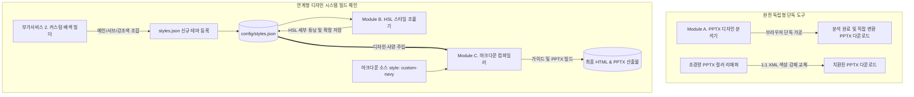

# Creative Spark V2.0 - Serverless Framework & Design Analyzer
## 📂 독립형 프로젝트 구동 및 가이드북 컴파일러 스위트

이 프로젝트(`cs_v2`)는 기존 Creative Spark V1.0 프로젝트에서 분리하여 **V2.0 에디터 및 PPTX 디자인 분석기 기능만 별도의 단독 프로젝트로 구축하여 즉시 빌드 및 실행할 수 있도록 구성된 독립형 패키지**입니다.

이 패키지는 오리지널 디자인 시스템의 라이트 테마(네이비 헤더 + 연청회색 배경) 디자인 기조를 따르며, 마크다운 가이드와 PPTX 포맷 교차 변환 및 실시간 HSL 테마 조율, PPTX 디자인 파싱/리매핑 기능을 탑재하고 있습니다.

---

## 1. 설치 및 구동 방법 (Quick Start)

본 프로젝트는 독립적으로 동작하므로 아래 단계를 통해 즉시 로컬 개발 서버를 가동하고 프로덕션 빌드를 수행할 수 있습니다.

### 패키지 의존성 설치
```bash
npm install
```
*(※ Vite 8.0 호환 플러그인이 탑재되어 있으므로, 별도의 `--legacy-peer-deps` 옵션 없이 원활하게 설치됩니다.)*

### 개발 서버 구동
```bash
npm run dev
```
개발 서버가 가동되면 브라우저를 통해 `http://localhost:8080`에 접속하여 V2 디자인 대시보드를 사용할 수 있습니다.

### 프로덕션 빌드
```bash
npm run build
```
빌드가 완료되면 빌드 결과물(정적 웹 리소스)이 `dist/` 폴더로 저장됩니다.

---

## 2. V2.0 프로젝트 핵심 모듈 관계 분석

각 모듈이 완전히 독립적으로 돌아가는 부분과, 상호 연계되어 돌아가는 데이터 흐름(연결고리)을 명확히 분류하여 안내합니다.



### 🟩 완전 독립형 단독 도구
1. **Module A. PPTX 디자인 분석기**
   - **관계성**: **완벽하게 독립적으로 동작하는 단독형 유틸리티**입니다.
   - **설명**: 사용자가 벤치마킹할 PPTX 파일을 로드하면 브라우저 내에서 직접 XML 구조를 해체하여 테마 색상과 폰트 기준을 분석하고 시각화해 줍니다. 나아가 타깃 PPTX의 서체/색상을 1:1로 치환하여 본래 프로젝트의 흐름과 무관하게 독립적으로 즉시 변환된 PPTX를 다운로드할 수 있습니다.
2. **초경량 PPTX 컬러 리매퍼 (부가서비스 3번)**
   - **관계성**: **완전 독립적인 1회성 보조 유틸리티**입니다.
   - **설명**: 가이드 문서 컴파일 및 변환 파이프라인과 아무런 데이터 연결이 없으며, 순수하게 구형 색상이 쓰인 PPTX 파일 내부의 XML 색상 코드를 원하는 세련된 신형 색상으로 1:1 일괄 강제 변경해 주는 독립 보조 도구입니다.

### 🟦 연계형 디자인 시스템 빌드 체인
* **[배색 조합 빌더] ➡️ [세부 HSL 조율(모듈 B)] ➡️ [마크다운 컴파일러(모듈 C)]**는 `styles.json` 디자인 설정 파일을 축으로 유기적으로 연결된 하나의 거대한 가이드 빌딩 파이프라인입니다.
1. **커스텀 배색 빌더 (부가서비스 2번)**
   - 사용자가 직접 **메인(Brand), 서브(Dark/Mid), 강조(Deep/Light), 배경(Bg), 테두리(Border)** 등 핵심 색상 세트를 피커로 새롭게 커스텀 조합하여 모형 UI의 조화를 확인하고, 새로운 영문 ID 테마로 `styles.json` 디자인 시스템에 직접 등록합니다.
2. **Module B. 실시간 스타일 조율기**
   - 배색 빌더나 프리셋을 통해 `styles.json`에 등록된 테마들의 세부 HSL 값이나 폰트 매핑 등을 미세 조율하고 서버에 최종 저장(Update)합니다.
3. **Module C. 마크다운 컴파일러**
   - 작성 중인 마크다운 문서의 Frontmatter에 `style: 영문-테마-ID`를 선언하면, 컴파일러 엔진이 해당 문서를 빌드할 때 `styles.json`에서 해당 ID의 색상과 서체 정의를 읽어와 템플릿(HTML)과 생성 슬라이드(PPTX)에 반영시킵니다.

---

## 2. 폴더 구조 및 파일 명세

```text
storage/v2plan/
├── README.md               # 본 문서 (모듈 연동 분석 및 마이그레이션 가이드)
├── v2.html                 # V2.0 단독 에디터 HTML 진입점
├── vite.config.ts          # v2.html 엔트리가 설정된 Vite 설정 파일
├── package.json            # jszip 라이브러리 의존성이 포함된 패키지 사양서
├── src/
│   └── v2/
│       ├── main-v2.tsx      # V2.0 메인 대시보드 뷰포트
│       └── components/
│           ├── PptxAnalyzer.tsx     # Module A. PPTX 디자인 분석 및 타깃 변환기 (독립형)
│           ├── VisualAdjuster.tsx   # Module B. 실시간 HSL 스타일 조율기 (연계형)
│           ├── MarkdownCompiler.tsx # Module C. 마크다운 컴파일러 & 실시간 프리뷰어 (연계형)
│           └── SubUtilities.tsx     # 부가서비스 (대비 검사기, 커스텀 배색 빌더, 컬러 리매퍼)
├── scripts/
│   └── v2/
│       ├── pptx-analyzer.js   # PPTX XML 구조 파싱 코어 엔진
│       └── spec-parser.js     # PPTX 디자인 스펙 데이터 파서
├── docs/
│   └── plan/
│       ├── master_refactoring_and_v2_plan.md    # V2 리팩토링 마스터 계획서
│       └── project_feasibility_analysis.md      # 아키텍처 실효성 분석 및 가독성/무결성 검증 설계서
└── config/
    └── v2/                  # V2.0 전용 추가 설정 스키마 보관 영역
```

---

## 3. 세부 기능 개선 사항 (피드백 반영 완료)

사용자의 명도 검사 및 커스텀 테마 등록 피드백을 반영하여 아래와 같이 기능을 대대적으로 개편했습니다.

### 1. 개별 색상 대비 검사기 (SECTION 1) 명도 대조 프리뷰 일치화
* **문제점**: 명도 대비 수치 설명은 흰색/검은색 두 가지를 제공하는데 시각적 프리뷰 카드의 구성이 맞지 않아 직관성이 떨어졌습니다.
* **개선**: 가독성 판별 결과 프리뷰를 3선 카드로 개편하여 아래 내용을 가시적으로 완벽히 매치시켰습니다:
  - **카드 1**: 흰색 배경(White BG) 위에 검사 중인 색상이 텍스트로 올라갈 때의 모습 및 가독성 판단(AA 통과 여부).
  - **카드 2**: 검은색 배경(Black BG) 위에 검사 중인 색상이 텍스트로 올라갈 때의 모습 및 가독성 판단(AA 통과 여부).
  - **카드 3**: 검사 중인 색상을 카드 블록 배경(Color Block BG)으로 채웠을 때 흰색 글씨와 검은색 글씨 중 어느 쪽이 가독성이 우수한지 한눈에 대조하는 프리뷰.
* **WCAG 2.0 판정 알고리즘 탑재**: 7.0 이상(AAA 매우 우수), 4.5 이상(AA 적합), 3.0 이상(AA 큰 글자 전용), 3.0 미만(부적합) 등 공식 등급 기준을 설명과 일치시켰습니다.

### 2. 추천 프리셋 및 사용자 커스텀 배색 테마 빌더 (SECTION 2) 신설
* **문제점**: 기존에는 프리셋 색상만 감상하고 저장할 뿐, 사용자가 메인색, 서브색, 강조색 등을 주도적으로 지정하여 테마를 생성할 수 없었습니다. 또한 누락된 디자인 프리셋이 있었습니다.
* **개선**:
  - **커스텀 배색 조율 패널**: 사용자가 메인 주컬러(Brand), 서브 어두운톤(Dark), 강조 깊은톤(Deep), 강조 연한배경(Light), 기본 배경색(Bg), 테두리(Border) 등을 컬러 피커나 HEX 입력창으로 **자유롭게 직접 커스텀 조합**할 수 있는 배색 조율 기능을 추가했습니다.
  - **실시간 목업 연동**: 조율한 색상 세트가 우측의 가이드북 실시간 Mock UI에 즉각 바인딩되어 디자인 조화를 시각적으로 바로 검증할 수 있습니다.
  - **디자인 시스템 자동 등록**: 조율이 완료된 나만의 커스텀 배색 테마를 원하는 영문 ID로 지정하여 `config/styles.json`에 원클릭으로 신규 등록(추가)할 수 있습니다.
  - **프리셋 복원**: 페이퍼로지 오리지널(블루), AI 챗봇(그린) 등 누락된 대표 배색 프리셋을 목록에 추가하여 즉시 불러와 커스텀 시작점으로 활용할 수 있도록 보강했습니다.

---

## 4. 새 프로젝트로 복사 및 이식 방법 (Migration Guide)

이 `storage/v2plan` 폴더의 구조를 다른 React-Vite 프로젝트로 복사해서 독립 구동할 때의 절차는 다음과 같습니다.

### 1단계: 파일 배치
- `v2.html`을 대상 프로젝트의 **루트 디렉토리**에 붙여넣습니다.
- `src/v2/` 및 `scripts/v2/` 폴더를 대상 프로젝트의 동일한 경로인 `src/`, `scripts/` 아래에 배치합니다.

### 2단계: 의존성 패키지 설치
PPTX 파일을 브라우저 단에서 zip 해제하고 파싱하기 위해 `jszip` 패키지가 필요합니다. 대상 프로젝트의 터미널에서 다음 명령을 실행합니다.
```bash
npm install jszip lucide-react
# 또는
yarn add jszip lucide-react
```

### 3단계: Vite 설정 추가 (`vite.config.ts`)
Vite 빌드 시 `v2.html`을 멀티 페이지 엔트리로 인식하도록 설정 파일의 `build.rollupOptions.input` 섹션에 `v2` 속성을 추가합니다.
```typescript
// vite.config.ts
export default defineConfig({
  build: {
    rollupOptions: {
      input: {
        main: path.resolve(__dirname, "index.html"),
        v2: path.resolve(__dirname, "v2.html"), // 이 줄을 추가합니다.
      },
    },
  },
});
```

### 4단계: 백엔드 API 미들웨어 연동 (필수)
모듈 B의 스타일 저장, 모듈 C의 마크다운 컴파일 및 저장 기능은 **Vite 개발 서버의 API 미들웨어**(`/api/save-styles`, `/api/preview`, `/api/save-generate` 등)를 경유합니다.
- `vite-api-plugin.ts` 등 API 미들웨어를 대상 프로젝트의 개발 서버 플러그인에 등록해야 컴파일러 엔진 및 프리뷰어가 정상 동작합니다.
