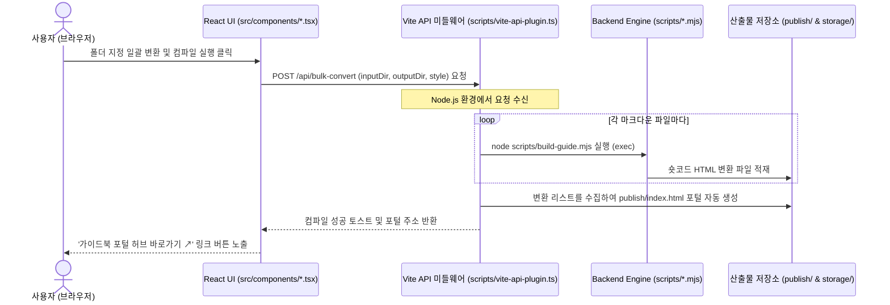

# Creative Spark V2.0 - Serverless Framework & Design Analyzer
## 📂 독립형 프로젝트 구동 및 가이드북 컴파일러 스위트

이 프로젝트(`cs_v2`)는 기존 Creative Spark V1.0 프로젝트에서 분리하여 **V2.0 에디터 및 PPTX 디자인 분석기 기능만 별도의 단독 프로젝트로 구축하여 즉시 빌드 및 실행할 수 있도록 구성된 독립형 패키지**입니다.

이 패키지는 오리지널 디자인 시스템의 라이트 테마(네이비 헤더 + 연청회색 배경) 디자인 기조를 따르며, 마크다운 가이드와 PPTX 포맷 교차 변환 및 실시간 HSL 테마 조율, PPTX 디자인 파싱/리매핑 기능을 탑재하고 있습니다.

---

## 1. 설치 및 구동 방법 (Quick Start)

본 프로젝트는 독립적으로 동작하므로 아래 단계를 통해 즉시 로컬 개발 서버를 가동하고 프로덕션 빌드를 수행할 수 있습니다.

### 패키지 의존성 설치
```bash
npm install
```
*(※ Vite 8.0 호환 플러그인이 탑재되어 있으므로, 별도의 `--legacy-peer-deps` 옵션 없이 원활하게 설치됩니다.)*

### 개발 서버 구동
```bash
npm run dev
```
개발 서버가 가동되면 브라우저를 통해 `http://localhost:8080`에 접속하여 V2 디자인 대시보드를 사용할 수 있습니다.

### 프로덕션 빌드
```bash
npm run build
```
빌드가 완료되면 리액트 앱 정적 빌드 결과물이 `dist/` 폴더로 저장됩니다.

---

## 2. 아키텍처 분석: React UI (src/ TSX) vs Backend Engine (scripts/ mjs)

본 프로젝트는 시각적 사용성을 다루는 **프론트엔드 UI 계층**과, 실제 파일을 제어하고 변환하는 **백엔드 엔진 계층**이 Vite API 미들웨어를 축으로 긴밀하게 연동되어 있습니다.



### 🎨 프론트엔드 UI 계층 (`src/` 하위 TSX 파일)
* **역할**: 사용자가 직접 웹 브라우저에서 조작하는 시각적인 **디자인 관리 센터 인터페이스**입니다.
* **주요 구성**:
  - `src/main.tsx`: 대시보드 탭 레이아웃 및 전체 뷰포트를 통제하는 메인 대시보드 뷰.
  - `src/components/MarkdownCompiler.tsx` (모듈 C): 실시간 마크다운 에디터, split-pane 미리보기 iframe 윈도우, 단일/일괄 폴더 변환 실행 및 컴파일 설정 패널.
  - `src/components/VisualAdjuster.tsx` (모듈 B): HSL 테마 값을 미세 튜닝하고 새로운 배색을 만들며 WCAG 대비도를 검사하는 디자인 조율 UI.
  - `src/components/PptxAnalyzer.tsx` (모듈 A): 벤치마킹할 PPTX를 로드하여 분석하고 색상을 XML 수준에서 1:1 리매핑하는 UI.

### ⚙️ 백엔드 엔진 계층 (`scripts/` 하위 mjs/js 파일)
* **역할**: 웹 화면의 변환/저장 요청을 받아 Node.js 환경에서 **실제 파일 IO 및 마크다운 파싱, PPTX 셰이프 드로잉을 전담하는 변환 코어 엔진**입니다.
* **주요 구성**:
  - `scripts/vite-api-plugin.ts`: 리액트 UI 화면(TSX)이 내보내는 API 요청을 받아 Node.js 프로세스로 엔진 코어를 호출해주는 브리지 미들웨어.
  - `scripts/build-guide.mjs`: 마크다운 ➡️ 가이드 HTML 숏코드 컴파일. (스타일 인라인화를 통한 standalone HTML 생성 전담)
  - `scripts/build-presentation.mjs`: 마크다운 ➡️ 웹 슬라이드 컴파일. (aspect-ratio 16:9 뷰 템플릿 렌더링)
  - `scripts/md-to-pptx.mjs`: 마크다운 ➡️ PowerPoint PPTX 파일 빌드.
  - `scripts/pptx-analyzer.js` & `spec-parser.js`: PPTX XML 구조 압축 해제 및 디자인 사양 데이터 추출/치환 코어.
  - `scripts/pptx-renderers/`: 각 개별 숏코드(git-flow, editor-box 등)의 PPTX 네이티브 드로잉 코어 렌더러 모듈들.

---

## 3. 평탄화된 폴더 구조 및 파일 명세

```text
cs_v2/
├── index.html              # V2.0 디자인 스위트 웹 대시보드 진입점
├── vite.config.ts          # 단일 index.html entry 시스템 Vite 설정 파일
├── package.json            # Vite 8.0 개발 사양 및 의존 패키지 선언서
├── tsconfig.json           # TS 빌드 및 컴파일 환경 설정
├── tailwind.config.ts      # Tailwind CSS 시스템 토큰 및 스타일 설정
├── src/
│   ├── main.tsx            # V2.0 메인 대시보드 뷰포트
│   ├── index.css           # Tailwind 기반 디자인 시스템 스타일 시트
│   └── components/
│       ├── PptxAnalyzer.tsx     # Module A. PPTX 디자인 분석 및 타깃 변환기 (독립형)
│       ├── VisualAdjuster.tsx   # Module B. 실시간 HSL 스타일 조율기 (연계형)
│       ├── MarkdownCompiler.tsx # Module C. 마크다운 컴파일러 & 실시간 프리뷰어 (연계형)
│       ├── PptxInspectorSuite.tsx # PPTX 디자인 분석 마스터 슬라이드 뷰어
│       ├── SubUtilities.tsx     # 부가서비스 (대비 검사기, 커스텀 배색 빌더, 컬러 리매퍼)
│       └── ui/                  # Shadcn UI 컴포넌트 라이브러리
├── scripts/
│   ├── vite-api-plugin.ts  # Vite 개발 서버 API 미들웨어 (Bridge)
│   ├── pptx-analyzer.js    # PPTX XML 구조 파싱 코어 엔진
│   ├── spec-parser.js      # PPTX 디자인 스펙 데이터 파서
│   ├── build-guide.mjs     # 마크다운 ➡️ 가이드 HTML 숏코드 컴파일 엔진
│   ├── build-presentation.mjs # 마크다운 ➡️ 웹 슬라이드 컴파일 엔진
│   └── md-to-pptx.mjs      # 마크다운 ➡️ PPTX 컴파일 엔진
├── docs/                   # V2.0 공식 마스터 문서 보관 공간
│   ├── docs_index.md       # 문서 시스템 종합 안내 홈 (README.md에서 명칭 변경)
│   ├── guide.md            # 사용자 기능 설명서
│   ├── scripts_guide.md    # 개발자 변환 코어 엔진 설명서
│   └── plan/               # 아키텍처 및 구현 기획 계획서 보관 폴더
├── config/
│   ├── styles.json         # 테마 배색 사전 설정 보관 JSON
│   └── layout.json         # [NEW] PPTX 분석 가공 오프셋 보관 JSON
├── md_src/                 # 마크다운 원천 소스 보관 폴더
├── publish/                # [산출물] 컴파일 완료된 가이드북 포털 및 HTML 저장소
└── storage/                # [산출물] 프레젠테이션/PPTX 파일 독립 보관 저장소
    ├── presentation/       # 변환된 Presentation HTML
    └── pptx/               # 변환된 PPTX 디자인 결과물
```�─ spec-parser.js     # PPTX 디자인 스펙 데이터 파서
├── docs/
│   └── plan/
│       ├── master_refactoring_and_v2_plan.md    # V2 리팩토링 마스터 계획서
│       └── project_feasibility_analysis.md      # 아키텍처 실효성 분석 및 가독성/무결성 검증 설계서
└── config/
    └── v2/                  # V2.0 전용 추가 설정 스키마 보관 영역
```

---

## 3. 세부 기능 개선 사항 (피드백 반영 완료)

사용자의 명도 검사 및 커스텀 테마 등록 피드백을 반영하여 아래와 같이 기능을 대대적으로 개편했습니다.

### 1. 개별 색상 대비 검사기 (SECTION 1) 명도 대조 프리뷰 일치화
* **문제점**: 명도 대비 수치 설명은 흰색/검은색 두 가지를 제공하는데 시각적 프리뷰 카드의 구성이 맞지 않아 직관성이 떨어졌습니다.
* **개선**: 가독성 판별 결과 프리뷰를 3선 카드로 개편하여 아래 내용을 가시적으로 완벽히 매치시켰습니다:
  - **카드 1**: 흰색 배경(White BG) 위에 검사 중인 색상이 텍스트로 올라갈 때의 모습 및 가독성 판단(AA 통과 여부).
  - **카드 2**: 검은색 배경(Black BG) 위에 검사 중인 색상이 텍스트로 올라갈 때의 모습 및 가독성 판단(AA 통과 여부).
  - **카드 3**: 검사 중인 색상을 카드 블록 배경(Color Block BG)으로 채웠을 때 흰색 글씨와 검은색 글씨 중 어느 쪽이 가독성이 우수한지 한눈에 대조하는 프리뷰.
* **WCAG 2.0 판정 알고리즘 탑재**: 7.0 이상(AAA 매우 우수), 4.5 이상(AA 적합), 3.0 이상(AA 큰 글자 전용), 3.0 미만(부적합) 등 공식 등급 기준을 설명과 일치시켰습니다.

### 2. 추천 프리셋 및 사용자 커스텀 배색 테마 빌더 (SECTION 2) 신설
* **문제점**: 기존에는 프리셋 색상만 감상하고 저장할 뿐, 사용자가 메인색, 서브색, 강조색 등을 주도적으로 지정하여 테마를 생성할 수 없었습니다. 또한 누락된 디자인 프리셋이 있었습니다.
* **개선**:
  - **커스텀 배색 조율 패널**: 사용자가 메인 주컬러(Brand), 서브 어두운톤(Dark), 강조 깊은톤(Deep), 강조 연한배경(Light), 기본 배경색(Bg), 테두리(Border) 등을 컬러 피커나 HEX 입력창으로 **자유롭게 직접 커스텀 조합**할 수 있는 배색 조율 기능을 추가했습니다.
  - **실시간 목업 연동**: 조율한 색상 세트가 우측의 가이드북 실시간 Mock UI에 즉각 바인딩되어 디자인 조화를 시각적으로 바로 검증할 수 있습니다.
  - **디자인 시스템 자동 등록**: 조율이 완료된 나만의 커스텀 배색 테마를 원하는 영문 ID로 지정하여 `config/styles.json`에 원클릭으로 신규 등록(추가)할 수 있습니다.
  - **프리셋 복원**: 페이퍼로지 오리지널(블루), AI 챗봇(그린) 등 누락된 대표 배색 프리셋을 목록에 추가하여 즉시 불러와 커스텀 시작점으로 활용할 수 있도록 보강했습니다.

---

## 4. 새 프로젝트로 복사 및 이식 방법 (Migration Guide)

이 `storage/v2plan` 폴더의 구조를 다른 React-Vite 프로젝트로 복사해서 독립 구동할 때의 절차는 다음과 같습니다.

### 1단계: 파일 배치
- `v2.html`을 대상 프로젝트의 **루트 디렉토리**에 붙여넣습니다.
- `src/v2/` 및 `scripts/v2/` 폴더를 대상 프로젝트의 동일한 경로인 `src/`, `scripts/` 아래에 배치합니다.

### 2단계: 의존성 패키지 설치
PPTX 파일을 브라우저 단에서 zip 해제하고 파싱하기 위해 `jszip` 패키지가 필요합니다. 대상 프로젝트의 터미널에서 다음 명령을 실행합니다.
```bash
npm install jszip lucide-react
# 또는
yarn add jszip lucide-react
```

### 3단계: Vite 설정 추가 (`vite.config.ts`)
Vite 빌드 시 `v2.html`을 멀티 페이지 엔트리로 인식하도록 설정 파일의 `build.rollupOptions.input` 섹션에 `v2` 속성을 추가합니다.
```typescript
// vite.config.ts
export default defineConfig({
  build: {
    rollupOptions: {
      input: {
        main: path.resolve(__dirname, "index.html"),
        v2: path.resolve(__dirname, "v2.html"), // 이 줄을 추가합니다.
      },
    },
  },
});
```

### 4단계: 백엔드 API 미들웨어 연동 (필수)
모듈 B의 스타일 저장, 모듈 C의 마크다운 컴파일 및 저장 기능은 **Vite 개발 서버의 API 미들웨어**(`/api/save-styles`, `/api/preview`, `/api/save-generate` 등)를 경유합니다.
- `vite-api-plugin.ts` 등 API 미들웨어를 대상 프로젝트의 개발 서버 플러그인에 등록해야 컴파일러 엔진 및 프리뷰어가 정상 동작합니다.
