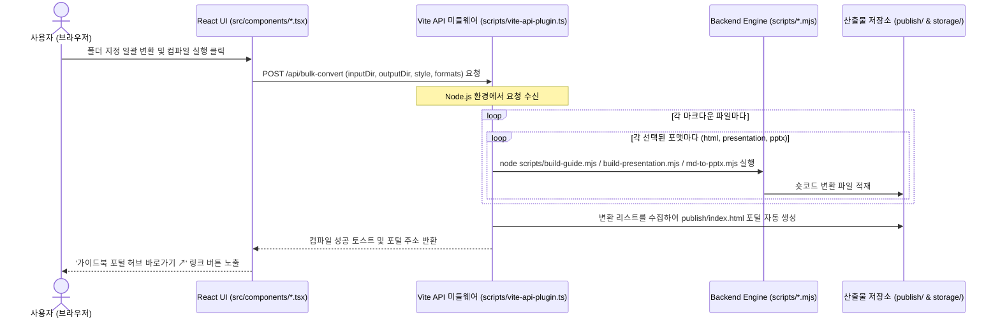

# Creative Spark V2.0 - Serverless Framework & Design Analyzer
## 📂 독립형 프로젝트 구동 및 가이드북 컴파일러 스위트

이 프로젝트(`cs_v2`)는 기존 Creative Spark V1.0 프로젝트에서 분리하여 **V2.0 에디터 및 PPTX 디자인 분석기 기능만 별도의 단독 프로젝트로 구축하여 즉시 빌드 및 실행할 수 있도록 구성된 독립형 패키지**입니다.

이 패키지는 오리지널 디자인 시스템의 라이트 테마(네이비 헤더 + 연청회색 배경) 디자인 기조를 따르며, 마크다운 가이드와 PPTX 포맷 교차 변환 및 실시간 HSL 테마 조율, PPTX 디자인 파싱/리매핑 기능을 탑재하고 있습니다.

---

## 1. 설치 및 구동 방법 (Quick Start)

본 프로젝트는 독립적으로 동작하므로 아래 단계를 통해 즉시 로컬 개발 서버를 가동하고 프로덕션 빌드를 수행할 수 있습니다.

### 패키지 의존성 설치
```bash
npm install
```
*(※ Vite 8.0 호환 플러그인이 탑재되어 있으므로, 별도의 `--legacy-peer-deps` 옵션 없이 원활하게 설치됩니다.)*

### 개발 서버 구동
```bash
npm run dev
```
개발 서버가 가동되면 브라우저를 통해 `http://localhost:8080`에 접속하여 V2 디자인 대시보드를 사용할 수 있습니다.

### 프로덕션 빌드
```bash
npm run build
```
빌드가 완료되면 리액트 앱 정적 빌드 결과물이 `dist/` 폴더로 저장됩니다.

---

## 2. 아키텍처 분석: React UI (src/ TSX) vs Backend Engine (scripts/ mjs)

본 프로젝트는 시각적 사용성을 다루는 **프론트엔드 UI 계층**과, 실제 파일을 제어하고 변환하는 **백엔드 엔진 계층**이 Vite API 미들웨어를 축으로 긴밀하게 연동되어 있습니다.



### 🎨 프론트엔드 UI 계층 (`src/` 하위 TSX 파일) — "웹 디자인 스위트" (2026-09 재편)
* **역할**: 사용자가 직접 웹 브라우저에서 조작하는 **3모듈 통합 디자인 스위트**입니다. `dashboard.html`(dev server) / `webdesignsuite.html`(standalone)이 3모듈을 탭으로 묶고, 각 모듈은 `design-system.html` / `guide-authoring.html` / `pptx-inspector.html`로 단독 배포도 가능합니다(워크플로 순서로 번호 부여 — 테마부터 정하고, 그 테마로 콘텐츠를 쓰고, 기존 PPTX 분석은 완전히 별개).
* **주요 구성**:
  - `src/main.tsx`: 3모듈(디자인 시스템/가이드북 저작/PPTX 인스펙터)을 동급 탭으로 배치하는 대시보드 셸.
  - `src/components/DesignSystemSuite.tsx` (**모듈 1**): `VisualAdjuster.tsx`(HSL 테마 조율·`styles.json` 등록)와 `SubUtilities.tsx`(대비 검사기·커스텀 배색 빌더·컬러 리매퍼)를 서브탭 2개로 묶은 통합 UI.
  - `src/components/MarkdownCompiler.tsx` (**모듈 2**): 실시간 마크다운 에디터, split-pane 미리보기 iframe 윈도우, 단일/일괄 폴더 변환 실행 및 컴파일 설정 패널.
  - `src/components/PptxInspectorSuite.tsx` (**모듈 3**): 벤치마킹할 PPTX를 로드하여 분석하고 색상을 XML 수준에서 1:1 리매핑하는 UI. 1·2번 모듈과 독립된 별개 워크플로.
  - `src/standalone/*-main.tsx`: 각 모듈을 서버 없이 단독 구동시키는 진입점(`design-system-main.tsx`/`guide-authoring-main.tsx`/`pptx-inspector-main.tsx`).

### ⚙️ 백엔드 엔진 계층 (`scripts/` 하위 mjs/js 파일)
* **역할**: 웹 화면의 변환/저장 요청을 받아 Node.js 환경에서 **실제 파일 IO 및 마크다운 파싱, PPTX 셰이프 드로잉을 전담하는 변환 코어 엔진**입니다.
* **주요 구성**:
  - `scripts/vite-api-plugin.ts`: 리액트 UI 화면(TSX)이 내보내는 API 요청을 받아 Node.js 프로세스로 엔진 코어를 호출해주는 브리지 미들웨어.
  - `scripts/guide-core.mjs` **(정본 코어)** / `scripts/presentation-core.mjs` **(정본 코어)**: 페이지 생성 전체(슬라이드 분할·템플릿·CSS·숏코드 렌더)를 담는 **환경 비의존**(fs/path 없음) 코어. CLI(build-guide/build-presentation)와 브라우저(client-compiler) 가 **동일 코어를 호출** → `standalone == server` 출력 보장.
  - `scripts/shortcode-render.mjs` **(공유 숏코드 렌더러)**: 숏코드 → HTML 변환 순수 함수. **guide-core** 가 사용(슬라이드는 presentation-core 자체 렌더러).
  - `scripts/shortcode-styles.mjs` **(공유 숏코드 CSS)**: 숏코드 컴포넌트 CSS. `var(--*)` 기반 테마 독립.
  - `scripts/build-guide.mjs` / `scripts/build-presentation.mjs`: 위 코어를 호출하는 **얇은 CLI 래퍼**(파일읽기+config로드+출력경로). 가이드 HTML / 16:9 웹 슬라이드.
  - `scripts/md-to-pptx.mjs`: 마크다운 ➡️ PowerPoint PPTX 파일 빌드. (폰트·크기 수치는 `config/pptdesign.config.json` 에서 로드 — 하드코딩 없음)
  - `scripts/pptx-analyzer.js` & `spec-parser.js`: PPTX XML 구조 압축 해제 및 디자인 사양 데이터 추출/치환 코어.
  - `scripts/pptx-renderers/`: 각 개별 숏코드(git-flow, editor-box 등)의 PPTX 네이티브 드로잉 코어 렌더러 모듈들.
  - `scripts/library-names.mjs` / `scripts/shape-set.mjs` **(공용 배치 카탈로그 연결)**: pptgen 과 같은 배치 이름(`grid.cards` 등)·색 이름을 cs_v2 숏코드로 해석하고, 서식 세트(외곽선·그림자·둥글기·보조 카드색)를 HTML 변수/PPTX 카드 서식으로 바꿉니다. 원본 카탈로그는 `config/library/`(복사본) — `npm run sync:library`. 상세: [`config/library/README.md`](config/library/README.md)

---

## 2-1. 빌드 파이프라인: 개별 파일 출력 vs 폴더 전체 허브(통합) 출력

md_src 아래 마크다운 원본은 **① 파일 1개당 3종 포맷**으로, 그리고 **② 폴더(컬렉션) 전체를 지정하면 그 폴더 전체를 하나로 묶은 "허브" 1개 파일**로도 만들 수 있습니다. 이 둘은 서로 다른 스크립트가 담당하며 출력 형태도 다릅니다.

### ① 파일 1개 → 3종 포맷 (종형 가이드 · 횡형 프레젠테이션 · PPTX)

| 포맷 | 명령 | 산출물 |
| --- | --- | --- |
| 종형 가이드 HTML | `node scripts/build-guide.mjs md_src/guides/Claude.md --out out.html` | 위→아래 스크롤 문서 (guide-core) |
| 횡형 프레젠테이션 HTML | `node scripts/build-presentation.mjs md_src/guides/Claude.md --out out.html` | 좌→우 슬라이드 덱 (presentation-core), 좌상단 ☰ 버튼으로 목차 토글 |
| PPTX | `node scripts/md-to-pptx.mjs md_src/guides/Claude.md --out out.pptx` | 파워포인트 파일 |

### ② 폴더 전체 → 통합 허브 1개 HTML (종형 vs 횡형 선택)

같은 폴더(예: `md_src/guides`, `md_src/claudeguide`)의 **모든 md 파일을 하나의 독립 실행 HTML**로 묶어야 할 때는 아래 두 가지 중 목적에 맞는 방식을 선택합니다. 둘 다 인터넷 연결 없이 파일 하나만으로 열립니다.

| 방식 | 명령 | 내비게이션 UX | 적합한 용도 |
| --- | --- | --- | --- |
| **횡형 통합 덱** | `node scripts/build-presentation.mjs "md_src/guides/*.md" --out publish/guides_slides.html` | 좌상단 ☰ 버튼 → 전체 슬라이드 목차 오버레이, 슬라이드 넘기듯 좌우 이동 | 발표·데모, 슬라이드 형태로 죽 훑어볼 때 |
| **종형 통합 허브(onepage)** | `npm run build:onepage -- --dir guides` (기본 출력: `publish/guides-onepage.html`, `--out`으로 경로 변경 가능) | 좌측 고정 사이드바(카테고리별, 열림/닫힘 토글) + 카드형 홈 화면, 클릭 시 해당 가이드 문서 전체를 그 자리에서 표시 — 서버 없이 파일 하나로 완결 | 레퍼런스처럼 필요한 도구를 찾아 읽을 때, 오프라인 배포용 "가이드북" |

**폴더 하나를 통째로 빌드**하려면(개별 html/presentation/pptx + 폴더 목록 `index.html` + 위 표의 두 통합 산출물까지) `npm run build:folder -- --dir guides`를 씁니다. 플래그 없이 실행하면 개별 3종 + 폴더 `index.html`이 기본 세트로 나오고, `md_src/<폴더>/hub.config.json`의 `outputs` 설정에 따라 onepage·통합 프레젠테이션 덱이 함께 생성됩니다(`--all`로 전부 강제 생성, `--onepage`/`--presentation-bundle`로 개별 지정 가능). 카테고리 라벨·표시 순서·사이드바 기본 열림 상태는 전부 이 `hub.config.json` 하나에서 관리하며, 폴더마다 독립적으로 설정합니다.

* `build-presentation.mjs`에 폴더 글롭(`*.md`)을 넘기면 **내부적으로 이미 다중 문서 병합을 지원**합니다 — 각 md의 표지가 슬라이드 목차의 챕터 구분점이 됩니다.
* `build-guide-hub.mjs`는 `--dir <md_src 하위 폴더명>` 하나만 바꾸면 `guides` 외에 `claudeguide` 등 **어떤 md_src 하위 폴더에도 동일하게 동작**합니다(임의의 md_src 밖 경로도 가능). `--out`을 여러 번 지정하면 같은 내용을 여러 경로에 동시 저장합니다. 사이드바 카테고리는 각 md의 frontmatter `style` 값을 기준으로 자동 분류되며, 라벨·색상·표시 순서는 `md_src/<폴더>/hub.config.json` 하나가 유일한 출처입니다(`scripts/hub-config.mjs`가 로더 — `sync-guides-index.mjs`도 같은 파일을 읽으므로 두 곳을 따로 고칠 필요가 없습니다).
* 상세 구현은 [`docs/scripts_guide.md`](./docs/scripts_guide.md) 3-1~3-3절 참고.

---

## 3. 평탄화된 폴더 구조 및 파일 명세

```text
cs_v2/
├── index.html              # dashboard.html로 즉시 리디렉션하는 얇은 스텁 (Vite 기본 root 관례 유지용)
├── dashboard.html          # 웹 디자인 스위트 대시보드(3모듈 통합 탭) — dev server 실제 진입점
├── design-system.html      # 모듈 1 단독 진입점 (standalone 빌드 대상)
├── guide-authoring.html    # 모듈 2 단독 진입점 (standalone 빌드 대상)
├── pptx-inspector.html     # 모듈 3 단독 진입점 (standalone 빌드 대상)
├── webdesignsuite.html     # 3모듈 통합 탭 standalone 진입점
├── vite.config.ts          # dev/일반 build 설정 (index.html + dashboard.html 두 엔트리 빌드)
├── vite.config.standalone.ts # standalone(단일 파일) 빌드 설정 — SA_ENTRY 환경변수로 4개 엔트리 중 선택
├── package.json            # Vite 8.0 개발 사양 및 의존 패키지 선언서
├── tsconfig.json           # TS 빌드 및 컴파일 환경 설정
├── tailwind.config.ts      # Tailwind CSS 시스템 토큰 및 스타일 설정
├── src/
│   ├── main.tsx            # 대시보드 뷰포트 — 모듈 1/2/3을 동급 탭으로 배치
│   ├── standalone/          # 모듈별 단독 구동 진입점 (design-system-main.tsx 등)
│   ├── index.css           # Tailwind 기반 디자인 시스템 스타일 시트
│   ├── hooks/
│   │   ├── use-toast.ts, use-mobile.tsx  # 공통 UI 훅
│   │   ├── theme-defaults.ts     # ThemeDetails 타입 + 기본/신규 테마 템플릿 상수 (단일 출처)
│   │   ├── useThemeEditor.ts     # 테마 프리셋 로드·선택 상태 (VisualAdjuster 3패널 공유, ≤200L)
│   │   └── useThemeMutations.ts  # 테마 추가/수정/삭제 + styles.json 서버 저장 로직
│   └── components/
│       ├── DesignSystemSuite.tsx # Module 1. VisualAdjuster+SubUtilities 통합 셸 (연계형, 저장은 서버 전용)
│       ├── VisualAdjuster.tsx    # (Module 1 서브탭) HSL 스타일 조율기 — useThemeEditor 훅 + 3패널 조합 오케스트레이터
│       ├── visual-adjuster/      # VisualAdjuster 하위 패널 (좌: 프리셋 목록 / 중: 편집 폼 / 우: 실시간 프리뷰)
│       │   ├── ThemePresetPanel.tsx, ThemeEditorPanel.tsx, ThemeLivePreviewPanel.tsx
│       ├── SubUtilities.tsx      # (Module 1 서브탭) 3개 독립 섹션(대비검사기/프리셋빌더/PPTX리매퍼) 조합 오케스트레이터
│       ├── sub-utilities/        # SubUtilities 하위 섹션 컴포넌트 (섹션별 상태 완전 독립)
│       │   ├── ContrastChecker.tsx, ContrastPreviewCards.tsx           # 1. 색상 사전 & 대비 검사기
│       │   ├── ThemePresetBuilder.tsx, ThemePresetSelector.tsx,
│       │   │   PaletteBuilderForm.tsx, PaletteLivePreview.tsx          # 2. 추천 프리셋 & 커스텀 배색 빌더
│       │   └── PptxColorRemapper.tsx, PptxUploadZone.tsx,
│       │       ColorMappingTable.tsx                                    # 3. PPTX 컬러 리매퍼
│       ├── MarkdownCompiler.tsx  # Module 2. 마크다운 컴파일러 & 실시간 프리뷰어 (연계형)
│       ├── PptxInspectorSuite.tsx # Module 3. PPTX 디자인 분석·리매퍼 (독립형, 서버리스)
│       └── ui/                  # Shadcn UI 컴포넌트 라이브러리
├── scripts/
│   ├── vite-api-plugin.ts  # Vite 개발 서버 API 미들웨어 (Bridge) — 웹 GUI의 저장/일괄변환 API
│   ├── pptx-analyzer.js    # PPTX XML 구조 파싱 코어 엔진
│   ├── spec-parser.js      # PPTX 디자인 스펙 데이터 파서
│   ├── shortcode-render.mjs   # [정본] 숏코드 → HTML 공유 렌더러 (3개 HTML 출력 공용)
│   ├── shortcode-ext/         # [정본] 기능 이름 배치 HTML 36종(계단·기둥·게이지·막대·인용·이미지·회사 패턴 상자…) + CSS
│   ├── shortcode-styles.mjs   # [정본] 숏코드 컴포넌트 CSS (var(--*) 테마 독립)
│   ├── guide-core.mjs      # 정본 코어: MD → 가이드 HTML (fs/path 비의존, CLI+client 공유)
│   ├── presentation-core.mjs # 정본 코어: MD → 16:9 슬라이드 HTML (fs/path 비의존, CLI+client 공유)
│   ├── build-guide.mjs     # guide-core 호출 CLI 래퍼 (npm run build:guide)
│   ├── build-presentation.mjs # presentation-core 호출 CLI 래퍼 (npm run build:presentation)
│   ├── build-standalone.mjs   # 웹앱(모듈 1/2/3) standalone 단일 HTML 빌드 — 콘텐츠 파이프라인과는 별개(npm run build:standalone)
│   ├── build-guide-hub.mjs # md_src/<dir> 전체를 사이드바+Shadow DOM onepage 단일 HTML로 병합 (npm run build:onepage)
│   ├── build-folder.mjs    # 폴더 단위 오케스트레이터 — 개별 3종+폴더 index.html+onepage+통합덱을 한 번에 (npm run build:folder)
│   ├── hub-config.mjs      # md_src/<dir>/hub.config.json 로더 — 카테고리 라벨·순서·UI 옵션 단일 출처
│   ├── sync-guides-index.mjs # md_src/guides → src/data/guides.json 동기화 (hub-config.mjs 기준으로 정렬)
│   ├── build-publish.mjs   # md_src 전체를 public/에 일괄 빌드하는 독립 유틸(현재 GUI에서는 호출 안 됨, 수동 실행용)
│   ├── md-to-pptx.mjs      # 마크다운 ➡️ PPTX 컴파일 엔진 (config 폰트 로드, npm run build:pptx)
│   ├── library-names.mjs   # 공용 배치 카탈로그 이름 해석(기능 이름·별칭 → 숏코드) + ::: 블록 정규식·제목 속성 제거·색 이름 단일 출처
│   ├── shape-set.mjs       # 서식 세트 → HTML CSS 변수 / PPTX 카드 서식(pal.shape)
│   ├── library-map.mjs     # [자동 생성] config/library 카탈로그의 import 용 생성본 (손으로 고치지 않음)
│   ├── sync-library.mjs    # 공용 카탈로그 원본 → config/library 복사 + library-map.mjs 생성 (npm run sync:library)
│   ├── migrate-names.mjs   # md 의 옛 배치 이름 → 기능 이름(+인수) 일괄 변환 (npm run migrate:names, --check)
│   └── pptx-renderers/     # 숏코드별 PPTX 드로잉 렌더러 모듈 + registry.mjs
├── docs/                   # V2.0 공식 마스터 문서 보관 공간
│   ├── docs_index.md       # 문서 시스템 종합 안내 홈
│   ├── guide.md            # 사용자 기능 설명서
│   ├── scripts_guide.md    # 개발자 변환 코어 엔진 설명서
│   ├── shortcode-reference.md # 숏코드 레퍼런스 (기능 이름 64종 + 배치 인수 + 옛 이름 표)
│   ├── shortcode-changelog.md # 숏코드 변경 이력
│   ├── worklog.md          # 세션별 작업 로그 (누적, 시점 기록)
│   ├── report/             # 코드 점검·분석 보고서 (시점 기록)
│   └── plan/               # 아키텍처 및 구현 기획 계획서 보관 폴더
├── config/
│   ├── styles.json         # 테마 배색 프리셋 (스타일별 폰트·색상, 선택적 크기 오버라이드)
│   ├── pptdesign.config.json  # PPTX 레이아웃·폰트 크기 기본값 (수치 단일 출처)
│   ├── htmldesign.config.json # HTML 폰트·크기 토큰 (guide/presentation 프로파일)
│   ├── font-aliases.json   # 폰트 alias → 실제 폰트명 매핑
│   ├── shortcode-guide.ts  # 숏코드 가이드 패널+삽입툴바 공용 데이터 (단일 출처, 분류·기능 이름은 카탈로그에서)
│   ├── library/            # 공용 배치 카탈로그 복사본(layouts.json 66종·shape-sets.json 6종) — pptgen 과 같은 규칙
│   └── layout.json         # PPTX 분석 가공 오프셋 보관 JSON
├── src/__tests__/          # Vitest — shortcode-conformance(정합성 130) + library-catalog(카탈로그 151) + layout-ext(배치 인수 54) 등 410건
├── md_src/                 # 마크다운 원천 소스 보관 폴더 (하위 폴더마다 hub.config.json 선택적 배치)
├── public/                 # [산출물, gitignore] 웹 GUI "가이드 컬렉션 저장" 시 Vite 개발서버가 서빙하는 재빌드 위치
├── publish/                # [산출물, gitignore] CLI 빌드 파이프라인(build-folder.mjs 등)의 기본 출력 위치
└── storage/                # [gitignore] 프레젠테이션/PPTX 독립 보관 + 외부 참고자료(storage/netlify 등)
    ├── presentation/       # 변환된 Presentation HTML
    └── pptx/               # 변환된 PPTX 디자인 결과물
```

---

## 3. 세부 기능 개선 사항 (피드백 반영 완료)

사용자의 명도 검사 및 커스텀 테마 등록 피드백을 반영하여 아래와 같이 기능을 대대적으로 개편했습니다.

### 1. 개별 색상 대비 검사기 (SECTION 1) 명도 대조 프리뷰 일치화
* **문제점**: 명도 대비 수치 설명은 흰색/검은색 두 가지를 제공하는데 시각적 프리뷰 카드의 구성이 맞지 않아 직관성이 떨어졌습니다.
* **개선**: 가독성 판별 결과 프리뷰를 3선 카드로 개편하여 아래 내용을 가시적으로 완벽히 매치시켰습니다:
  - **카드 1**: 흰색 배경(White BG) 위에 검사 중인 색상이 텍스트로 올라갈 때의 모습 및 가독성 판단(AA 통과 여부).
  - **카드 2**: 검은색 배경(Black BG) 위에 검사 중인 색상이 텍스트로 올라갈 때의 모습 및 가독성 판단(AA 통과 여부).
  - **카드 3**: 검사 중인 색상을 카드 블록 배경(Color Block BG)으로 채웠을 때 흰색 글씨와 검은색 글씨 중 어느 쪽이 가독성이 우수한지 한눈에 대조하는 프리뷰.
* **WCAG 2.0 판정 알고리즘 탑재**: 7.0 이상(AAA 매우 우수), 4.5 이상(AA 적합), 3.0 이상(AA 큰 글자 전용), 3.0 미만(부적합) 등 공식 등급 기준을 설명과 일치시켰습니다.

### 2. 추천 프리셋 및 사용자 커스텀 배색 테마 빌더 (SECTION 2) 신설
* **문제점**: 기존에는 프리셋 색상만 감상하고 저장할 뿐, 사용자가 메인색, 서브색, 강조색 등을 주도적으로 지정하여 테마를 생성할 수 없었습니다. 또한 누락된 디자인 프리셋이 있었습니다.
* **개선**:
  - **커스텀 배색 조율 패널**: 사용자가 메인 주컬러(Brand), 서브 어두운톤(Dark), 강조 깊은톤(Deep), 강조 연한배경(Light), 기본 배경색(Bg), 테두리(Border) 등을 컬러 피커나 HEX 입력창으로 **자유롭게 직접 커스텀 조합**할 수 있는 배색 조율 기능을 추가했습니다.
  - **실시간 목업 연동**: 조율한 색상 세트가 우측의 가이드북 실시간 Mock UI에 즉각 바인딩되어 디자인 조화를 시각적으로 바로 검증할 수 있습니다.
  - **디자인 시스템 자동 등록**: 조율이 완료된 나만의 커스텀 배색 테마를 원하는 영문 ID로 지정하여 `config/styles.json`에 원클릭으로 신규 등록(추가)할 수 있습니다.
  - **프리셋 복원**: 페이퍼로지 오리지널(블루), AI 챗봇(그린) 등 누락된 대표 배색 프리셋을 목록에 추가하여 즉시 불러와 커스텀 시작점으로 활용할 수 있도록 보강했습니다.

### 3. 🧩 전체 숏코드 선택 삽입 에디터 툴바 (기능 이름 64종 — 공용 카탈로그 66종 중 cs_v2 직접 구현)
* **개선**: V2 컴파일러가 직접 그리는 **64종 배치** 전체를 드롭다운으로 제공합니다(2026-10-14 C 단계: 예전 "근사" 36종 — 계단·기둥·게이지·막대·천칭·인용·이미지 자리·회사 패턴 상자 — 을 전용 HTML 로. PPTX 는 그중 28종이 같은 모양, 나머지는 가까운 숏코드로 빠르게 근사하고 정밀 PPTX 는 pptgen). pptgen 과 같은 배치 인수(`badge`·`connector`·`emphasis`·`grow`·`header`·`caption`…)와 항목 `tag: alt`(그 카드만 보조 카드색)도 받습니다. 이름은 공용 배치 카탈로그의 **기능 이름 하나**(`grid.cards`, `compare.pair`…)로 운영하며(2026-10-14), 메뉴·스니펫도 카탈로그(pptgen 과 같은 예시)에서 나옵니다. 옛 이름(`icon-grid`…)으로 쓴 문서는 빌드 시 경고가 나오고 `npm run migrate:names` 로 일괄 변환합니다.
* **단일 출처 데이터**: 가이드 패널 설명과 삽입 스니펫은 `config/shortcode-guide.ts` **한 파일**에서 관리됩니다(중복 제거). 숏코드 설명/예시 수정 시 이 파일만 고치면 가이드 패널·삽입 버튼에 동시 반영됩니다.
* **기능·표현별 그룹 구성**: 학습 콘텐츠용 옛 분류(콘텐츠 그리드·정보 & 알림 등) 대신 카탈로그 그룹(분할·카드 / 비교·대조 / 순서·흐름 / 구조·관계 / 데이터·수치 / 서술·강조 / 코드·터미널 / 탐색·목록)으로 정리되며(pptgen 과 같음), 선택 삽입 시 YAML 규격 템플릿이 커서 위치에 자동 삽입됩니다.

### 4. 네이티브 폴더 선택기 & 멀티포맷 일괄 폴더 변환
* **개선**: 웹 브라우저 보안 제약으로 발생하던 로컬 절대 경로 입력의 불편을 제거하기 위해 백엔드와 연동된 **윈도우 네이티브 폴더 선택 탐색기(PowerShell FolderBrowserDialog)**를 도입하여 원클릭으로 경로를 자동 완성 및 바인딩할 수 있습니다.
* **멀티포맷 일괄 변환**: 폴더 일괄 컴파일 시 HTML뿐만 아니라 슬라이드(Presentation) 및 PPTX 파워포인트 파일을 동시 다중 생성 또는 독립 변환이 가능해졌으며, 생성 완료된 가이드북 포털 페이지(`index.html`)에서 다운로드 및 바로보기 링크들이 반응형 카드로 자동 취합 및 목록화됩니다.

---

## 4. 독립 프로젝트 평탄화 완료
* 본 프로젝트는 평탄화가 완료되어 별도로 이식 가이드를 따를 필요가 없습니다. `C:\ai\cs_v2` 하위에서 바로 `npm run dev` 또는 `npm run build`를 구동하시면 단독 프로젝트로서 정상 동작합니다.
