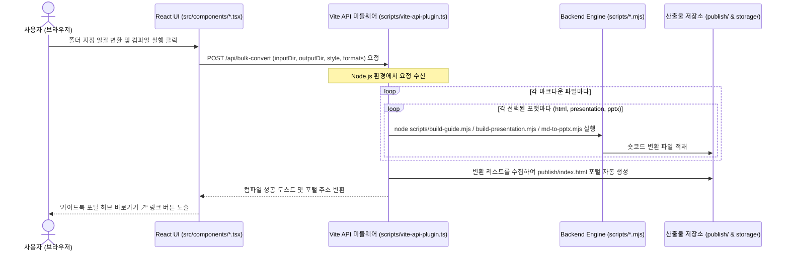

# Creative Spark V2.0 - Serverless Framework & Design Analyzer
## 📂 독립형 프로젝트 구동 및 가이드북 컴파일러 스위트

이 프로젝트(`cs_v2`)는 기존 Creative Spark V1.0 프로젝트에서 분리하여 **V2.0 에디터 및 PPTX 디자인 분석기 기능만 별도의 단독 프로젝트로 구축하여 즉시 빌드 및 실행할 수 있도록 구성된 독립형 패키지**입니다.

이 패키지는 오리지널 디자인 시스템의 라이트 테마(네이비 헤더 + 연청회색 배경) 디자인 기조를 따르며, 마크다운 가이드와 PPTX 포맷 교차 변환 및 실시간 HSL 테마 조율, PPTX 디자인 파싱/리매핑 기능을 탑재하고 있습니다.

---

## 1. 설치 및 구동 방법 (Quick Start)

본 프로젝트는 독립적으로 동작하므로 아래 단계를 통해 즉시 로컬 개발 서버를 가동하고 프로덕션 빌드를 수행할 수 있습니다.

### 패키지 의존성 설치
```bash
npm install
```
*(※ Vite 8.0 호환 플러그인이 탑재되어 있으므로, 별도의 `--legacy-peer-deps` 옵션 없이 원활하게 설치됩니다.)*

### 개발 서버 구동
```bash
npm run dev
```
개발 서버가 가동되면 브라우저를 통해 `http://localhost:8080`에 접속하여 V2 디자인 대시보드를 사용할 수 있습니다.

### 프로덕션 빌드
```bash
npm run build
```
빌드가 완료되면 리액트 앱 정적 빌드 결과물이 `dist/` 폴더로 저장됩니다.

---

## 2. 아키텍처 분석: React UI (src/ TSX) vs Backend Engine (scripts/ mjs)

본 프로젝트는 시각적 사용성을 다루는 **프론트엔드 UI 계층**과, 실제 파일을 제어하고 변환하는 **백엔드 엔진 계층**이 Vite API 미들웨어를 축으로 긴밀하게 연동되어 있습니다.



### 🎨 프론트엔드 UI 계층 (`src/` 하위 TSX 파일)
* **역할**: 사용자가 직접 웹 브라우저에서 조작하는 시각적인 **디자인 관리 센터 인터페이스**입니다.
* **주요 구성**:
  - `src/main.tsx`: 대시보드 탭 레이아웃 및 전체 뷰포트를 통제하는 메인 대시보드 뷰.
  - `src/components/MarkdownCompiler.tsx` (모듈 C): 실시간 마크다운 에디터, split-pane 미리보기 iframe 윈도우, 단일/일괄 폴더 변환 실행 및 컴파일 설정 패널.
  - `src/components/VisualAdjuster.tsx` (모듈 B): HSL 테마 값을 미세 튜닝하고 새로운 배색을 만들며 WCAG 대비도를 검사하는 디자인 조율 UI.
  - `src/components/PptxAnalyzer.tsx` (모듈 A): 벤치마킹할 PPTX를 로드하여 분석하고 색상을 XML 수준에서 1:1 리매핑하는 UI.

### ⚙️ 백엔드 엔진 계층 (`scripts/` 하위 mjs/js 파일)
* **역할**: 웹 화면의 변환/저장 요청을 받아 Node.js 환경에서 **실제 파일 IO 및 마크다운 파싱, PPTX 셰이프 드로잉을 전담하는 변환 코어 엔진**입니다.
* **주요 구성**:
  - `scripts/vite-api-plugin.ts`: 리액트 UI 화면(TSX)이 내보내는 API 요청을 받아 Node.js 프로세스로 엔진 코어를 호출해주는 브리지 미들웨어.
  - `scripts/guide-core.mjs` **(정본 코어)** / `scripts/presentation-core.mjs` **(정본 코어)**: 페이지 생성 전체(슬라이드 분할·템플릿·CSS·숏코드 렌더)를 담는 **환경 비의존**(fs/path 없음) 코어. CLI(build-guide/build-presentation)와 브라우저(client-compiler) 가 **동일 코어를 호출** → `standalone == server` 출력 보장.
  - `scripts/shortcode-render.mjs` **(공유 숏코드 렌더러)**: 숏코드 → HTML 변환 순수 함수. **guide-core** 가 사용(슬라이드는 presentation-core 자체 렌더러).
  - `scripts/shortcode-styles.mjs` **(공유 숏코드 CSS)**: 숏코드 컴포넌트 CSS. `var(--*)` 기반 테마 독립.
  - `scripts/build-guide.mjs` / `scripts/build-presentation.mjs`: 위 코어를 호출하는 **얇은 CLI 래퍼**(파일읽기+config로드+출력경로). 가이드 HTML / 16:9 웹 슬라이드.
  - `scripts/md-to-pptx.mjs`: 마크다운 ➡️ PowerPoint PPTX 파일 빌드. (폰트·크기 수치는 `config/pptdesign.config.json` 에서 로드 — 하드코딩 없음)
  - `scripts/pptx-analyzer.js` & `spec-parser.js`: PPTX XML 구조 압축 해제 및 디자인 사양 데이터 추출/치환 코어.
  - `scripts/pptx-renderers/`: 각 개별 숏코드(git-flow, editor-box 등)의 PPTX 네이티브 드로잉 코어 렌더러 모듈들.

---

## 3. 평탄화된 폴더 구조 및 파일 명세

```text
cs_v2/
├── index.html              # V2.0 디자인 스위트 웹 대시보드 진입점
├── vite.config.ts          # 단일 index.html entry 시스템 Vite 설정 파일
├── package.json            # Vite 8.0 개발 사양 및 의존 패키지 선언서
├── tsconfig.json           # TS 빌드 및 컴파일 환경 설정
├── tailwind.config.ts      # Tailwind CSS 시스템 토큰 및 스타일 설정
├── src/
│   ├── main.tsx            # V2.0 메인 대시보드 뷰포트
│   ├── index.css           # Tailwind 기반 디자인 시스템 스타일 시트
│   └── components/
│       ├── PptxAnalyzer.tsx     # Module A. PPTX 디자인 분석 및 타깃 변환기 (독립형)
│       ├── VisualAdjuster.tsx   # Module B. 실시간 HSL 스타일 조율기 (연계형)
│       ├── MarkdownCompiler.tsx # Module C. 마크다운 컴파일러 & 실시간 프리뷰어 (연계형)
│       ├── PptxInspectorSuite.tsx # PPTX 디자인 분석 마스터 슬라이드 뷰어
│       ├── SubUtilities.tsx     # 부가서비스 (대비 검사기, 커스텀 배색 빌더, 컬러 리매퍼)
│       └── ui/                  # Shadcn UI 컴포넌트 라이브러리
├── scripts/
│   ├── vite-api-plugin.ts  # Vite 개발 서버 API 미들웨어 (Bridge)
│   ├── pptx-analyzer.js    # PPTX XML 구조 파싱 코어 엔진
│   ├── spec-parser.js      # PPTX 디자인 스펙 데이터 파서
│   ├── shortcode-render.mjs   # [정본] 숏코드 → HTML 공유 렌더러 (3개 HTML 출력 공용)
│   ├── shortcode-styles.mjs   # [정본] 숏코드 컴포넌트 CSS (var(--*) 테마 독립)
│   ├── guide-core.mjs      # 정본 코어: MD → 가이드 HTML (fs/path 비의존, CLI+client 공유)
│   ├── presentation-core.mjs # 정본 코어: MD → 16:9 슬라이드 HTML (fs/path 비의존, CLI+client 공유)
│   ├── build-guide.mjs     # guide-core 호출 CLI 래퍼
│   ├── build-presentation.mjs # presentation-core 호출 CLI 래퍼
│   ├── build-standalone.mjs   # standalone 단일 HTML 빌드 (정합성 테스트 게이트)
│   ├── md-to-pptx.mjs      # 마크다운 ➡️ PPTX 컴파일 엔진 (config 폰트 로드)
│   └── pptx-renderers/     # 숏코드별 PPTX 드로잉 렌더러 모듈 + registry.mjs
├── docs/                   # V2.0 공식 마스터 문서 보관 공간
│   ├── docs_index.md       # 문서 시스템 종합 안내 홈
│   ├── guide.md            # 사용자 기능 설명서
│   ├── scripts_guide.md    # 개발자 변환 코어 엔진 설명서
│   ├── shortcode-reference.md # 숏코드 레퍼런스 (25 정식 + 13 alias)
│   ├── shortcode-changelog.md # 숏코드 변경 이력
│   ├── report/             # 코드 점검·분석 보고서 (시점 기록)
│   └── plan/               # 아키텍처 및 구현 기획 계획서 보관 폴더
├── config/
│   ├── styles.json         # 테마 배색 프리셋 (스타일별 폰트·색상, 선택적 크기 오버라이드)
│   ├── pptdesign.config.json  # PPTX 레이아웃·폰트 크기 기본값 (수치 단일 출처)
│   ├── htmldesign.config.json # HTML 폰트·크기 토큰 (guide/presentation 프로파일)
│   ├── font-aliases.json   # 폰트 alias → 실제 폰트명 매핑
│   ├── shortcode-guide.ts  # 숏코드 가이드 패널+삽입툴바 공용 데이터 (단일 출처)
│   └── layout.json         # PPTX 분석 가공 오프셋 보관 JSON
├── src/__tests__/          # Vitest — shortcode-conformance(정합성) 등 148건
├── md_src/                 # 마크다운 원천 소스 보관 폴더
├── publish/                # [산출물] 컴파일 완료된 가이드북 포털 및 HTML 저장소
└── storage/                # [산출물] 프레젠테이션/PPTX 파일 독립 보관 저장소
    ├── presentation/       # 변환된 Presentation HTML
    └── pptx/               # 변환된 PPTX 디자인 결과물
```

---

## 3. 세부 기능 개선 사항 (피드백 반영 완료)

사용자의 명도 검사 및 커스텀 테마 등록 피드백을 반영하여 아래와 같이 기능을 대대적으로 개편했습니다.

### 1. 개별 색상 대비 검사기 (SECTION 1) 명도 대조 프리뷰 일치화
* **문제점**: 명도 대비 수치 설명은 흰색/검은색 두 가지를 제공하는데 시각적 프리뷰 카드의 구성이 맞지 않아 직관성이 떨어졌습니다.
* **개선**: 가독성 판별 결과 프리뷰를 3선 카드로 개편하여 아래 내용을 가시적으로 완벽히 매치시켰습니다:
  - **카드 1**: 흰색 배경(White BG) 위에 검사 중인 색상이 텍스트로 올라갈 때의 모습 및 가독성 판단(AA 통과 여부).
  - **카드 2**: 검은색 배경(Black BG) 위에 검사 중인 색상이 텍스트로 올라갈 때의 모습 및 가독성 판단(AA 통과 여부).
  - **카드 3**: 검사 중인 색상을 카드 블록 배경(Color Block BG)으로 채웠을 때 흰색 글씨와 검은색 글씨 중 어느 쪽이 가독성이 우수한지 한눈에 대조하는 프리뷰.
* **WCAG 2.0 판정 알고리즘 탑재**: 7.0 이상(AAA 매우 우수), 4.5 이상(AA 적합), 3.0 이상(AA 큰 글자 전용), 3.0 미만(부적합) 등 공식 등급 기준을 설명과 일치시켰습니다.

### 2. 추천 프리셋 및 사용자 커스텀 배색 테마 빌더 (SECTION 2) 신설
* **문제점**: 기존에는 프리셋 색상만 감상하고 저장할 뿐, 사용자가 메인색, 서브색, 강조색 등을 주도적으로 지정하여 테마를 생성할 수 없었습니다. 또한 누락된 디자인 프리셋이 있었습니다.
* **개선**:
  - **커스텀 배색 조율 패널**: 사용자가 메인 주컬러(Brand), 서브 어두운톤(Dark), 강조 깊은톤(Deep), 강조 연한배경(Light), 기본 배경색(Bg), 테두리(Border) 등을 컬러 피커나 HEX 입력창으로 **자유롭게 직접 커스텀 조합**할 수 있는 배색 조율 기능을 추가했습니다.
  - **실시간 목업 연동**: 조율한 색상 세트가 우측의 가이드북 실시간 Mock UI에 즉각 바인딩되어 디자인 조화를 시각적으로 바로 검증할 수 있습니다.
  - **디자인 시스템 자동 등록**: 조율이 완료된 나만의 커스텀 배색 테마를 원하는 영문 ID로 지정하여 `config/styles.json`에 원클릭으로 신규 등록(추가)할 수 있습니다.
  - **프리셋 복원**: 페이퍼로지 오리지널(블루), AI 챗봇(그린) 등 누락된 대표 배색 프리셋을 목록에 추가하여 즉시 불러와 커스텀 시작점으로 활용할 수 있도록 보강했습니다.

### 3. 🧩 전체 숏코드 선택 삽입 에디터 툴바 (25 정식 + 13 alias = 38 규격)
* **개선**: V2 컴파일러와 PPTX 변환기가 지원하는 **25종 정식 숏코드 + 13종 별칭** 전체를 드롭다운으로 제공합니다.
* **단일 출처 데이터**: 가이드 패널 설명과 삽입 스니펫은 `config/shortcode-guide.ts` **한 파일**에서 관리됩니다(중복 제거). 숏코드 설명/예시 수정 시 이 파일만 고치면 가이드 패널·삽입 버튼에 동시 반영됩니다.
* **용도별 카테고리 구성**: 비교/대조, 코드/터미널, 흐름도 등 6가지 카테고리로 정리되며, 선택 삽입 시 YAML 규격 템플릿이 커서 위치에 자동 삽입됩니다.

### 4. 네이티브 폴더 선택기 & 멀티포맷 일괄 폴더 변환
* **개선**: 웹 브라우저 보안 제약으로 발생하던 로컬 절대 경로 입력의 불편을 제거하기 위해 백엔드와 연동된 **윈도우 네이티브 폴더 선택 탐색기(PowerShell FolderBrowserDialog)**를 도입하여 원클릭으로 경로를 자동 완성 및 바인딩할 수 있습니다.
* **멀티포맷 일괄 변환**: 폴더 일괄 컴파일 시 HTML뿐만 아니라 슬라이드(Presentation) 및 PPTX 파워포인트 파일을 동시 다중 생성 또는 독립 변환이 가능해졌으며, 생성 완료된 가이드북 포털 페이지(`index.html`)에서 다운로드 및 바로보기 링크들이 반응형 카드로 자동 취합 및 목록화됩니다.

---

## 4. 독립 프로젝트 평탄화 완료
* 본 프로젝트는 평탄화가 완료되어 별도로 이식 가이드를 따를 필요가 없습니다. `C:\ai\cs_v2` 하위에서 바로 `npm run dev` 또는 `npm run build`를 구동하시면 단독 프로젝트로서 정상 동작합니다.
