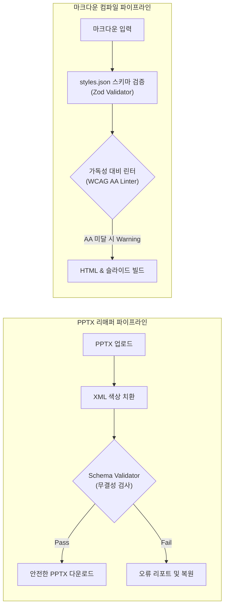

# Creative Spark V2.0 프로젝트 통합 vs 독립구조 실효성 분석 보고서
## 📝 아키텍처 대안 비교 및 실질적 검증·테스트 파이프라인 설계

이 보고서는 임의 통합된 V2.0 에디터의 미스매치 요소를 진단하고, 이를 극복하기 위해 **"유기적 파이프라인 강화(통합주의)"**와 **"3개 도구 격리(독립주의)"** 중 어떤 방향이 프로젝트의 실효성을 극대화할 수 있는지 검토합니다. 또한 부가서비스의 재배치 제안 및 실무 가치를 높이기 위한 구체적인 **품질 검증 자동화 테스트 방안**을 수립합니다.

---

## 1. 아키텍처 진단 및 대안 검토

현재 통합본은 PPTX 파일을 바이너리로 가공하는 기술(바이너리/클라이언트 단독)과 마크다운 가이드를 웹/슬라이드로 빌드하는 기술(백엔드/API 의존)이 섞여 있어 사용자 흐름이 부자연스럽습니다.

### 📌 대안 1: 유기적 파이프라인 강화 (통합주의)
* **목표**: 3개 모듈 간 데이터 연결 통로(API 및 상태 전송)를 촘촘히 엮어 막힘없는 순차적 파이프라인 구축.
* **연계 시나리오**:
  1. **모듈 A**에서 PPTX를 파싱해 추출한 색상을 클릭하면 ➡️ **부가서비스의 커스텀 테마 빌더**의 메인/서브색 필드로 자동 전송됩니다.
  2. 빌더에서 다듬은 테마를 ➡️ **디자인 시스템(`styles.json`)**에 신규 테마로 등록합니다.
  3. **모듈 B**에서 이 등록 테마의 세부 HSL 토큰을 튜닝하고 ➡️ **모듈 C(컴파일러)**가 마크다운 빌드 시 이 색상을 주입해 가이드를 출력합니다.
* **평가**: 흐름은 완벽해지나, 컴파일러 기능이 필요 없는 단순 PPTX 디자인 분석/가공 사용자(디자이너군)에게는 무거운 API 서버 실행 환경이 강제되는 오버헤드가 발생합니다.

### 📌 대안 2: 3대 영역 독립 도구화 및 분리 (독립주의 - ★추천★)
* **목표**: 상호 기술적 의존성과 사용자 타깃이 다른 모듈을 독립형 단독 툴 패키지로 명확히 떼어내 실용성 극대화.
* **도구 1: PPTX 디자인 인스펙터 & 튜너 (구 모듈 A + 부가서비스 3번)**
  - **역할**: PPTX 파일의 디자인 사양(폰트, 색상, 레이아웃)을 벤치마킹 분석하고, 특정 구형 색상을 XML 상에서 1:1 리매핑하여 강제 치환하는 자가완결 도구.
  - **특징**: 백엔드 API와 완전히 단절되어 **브라우저 단독(서버리스)으로 구동**하므로 오프라인 single HTML로 단독 배포/사용이 가능합니다.
* **도구 2: 마크다운 디자인 시스템 컴파일러 (구 모듈 B + 모듈 C)**
  - **역할**: 마크다운을 통해 웹 가이드북 및 슬라이드를 생성하되, 디자인 시스템(`styles.json`) 규격을 중심축으로 동작하는 문서화 빌딩 툴.
  - **특징**: **부가서비스의 가독성 대비 검사기 및 커스텀 테마 빌더가 모듈 B의 내부 기능으로 완벽하게 흡수**되어 텍스트 빌드에 특화됩니다.
* **도구 3: 추천 배색 및 디자인 가이드 라이브러리 (구 부가서비스 2번)**
  - **역할**: 실시간 테마 프리뷰 영감을 주는 독립 리소스 공유소.
* **평가**: **가장 강력히 추천하는 방향**입니다. 도구의 목적이 극대화되며, 특히 PPTX 가공 기능은 설치 없이 단일 HTML 파일 형태로 디자이너 및 실무진에게 즉각적으로 배포되어 높은 범용성을 확보합니다.

---

## 2. 부가서비스의 모듈 B(스타일 조율기)로의 흡수 통합 타당성 검토

부가서비스 중 **'대비도 검사기'**와 **'사용자 정의 배색 빌더'**는 모듈 B(스타일 조율기)로 흡수 통합되어야 시너지가 극대화됩니다.

* **가독성 대비 검사기 ➡️ 모듈 B 통합**:
  - 모듈 B에서 테마의 HSL 값(Luminance, Saturation 등)을 실시간 조율할 때, 화면 옆에 **"현재 바뀐 색상 조합의 WCAG 가독성 대비율(합격/불합격)"**이 실시간 검사기로 연동되어야 피드백 루프가 완성됩니다. (따로 떨어져 있으면 색상 수치를 일일이 복사해서 부가서비스에 붙여넣어야 하는 불편함 발생)
* **커스텀 배색 빌더 ➡️ 모듈 B 통합**:
  - 모듈 B의 기존 테마 상세 조율 폼과 배색 빌더의 입력 폼(Brand, Dark, Light 등)이 일치하므로, 모듈 B 내에서 **[1. 기존 테마 미세 튜닝]**과 **[2. 새 배색으로 테마 만들기 (빌더)]**로 서브 모드로 묶는 것이 레이아웃 재사용 및 UX 측면에서 훨씬 일관성 있습니다.

---

## 3. 실효성 확보를 위한 '품질 검증 및 테스트 자동화' 설계

이 프로젝트가 실무 환경(디자이너-개발자-작성자 협업)에서 단순한 프로토타입을 넘어 유용한 도구로 인정받기 위해 필요한 구체적인 테스트 자동화 파이프라인 설계안입니다.



### 🧪 1. PPTX XML 무결성 검증 테스트 (Schema Validator)
* **목적**: JSZip을 이용한 OpenXML 텍스트 단순 치환 작업 시, XML 구조의 훼손(태그 매칭 에러, 특수 문자 깨짐 등)으로 인해 결과물 PPTX가 파워포인트 앱에서 열리지 않는 사고를 사전에 방지합니다.
* **검증 기술 구현**:
  ```javascript
  // 가상 XML 무결성 테스트 로직 예시
  function validateXmlStructure(xmlString) {
    const parser = new DOMParser();
    const xmlDoc = parser.parseFromString(xmlString, "text/xml");
    const parserError = xmlDoc.getElementsByTagName("parsererror");
    if (parserError.length > 0) {
      throw new Error("XML 파싱 에러 발생: " + parserError[0].textContent);
    }
    return true;
  }
  ```
* **동작**: PPTX 패키징(`generateAsync`) 전, 수정된 모든 `ppt/slides/slide*.xml` 파일과 `ppt/presentation.xml`에 대해 파싱 테스트를 통과해야만 최종 파일 다운로드를 승인합니다.

### 🧪 2. 컴파일 타임 WCAG 가독성 린터 (Contrast Linter)
* **목적**: 마크다운 컴파일러(모듈 C) 빌드 실행 시, 사용자가 선언한 스타일의 텍스트와 배경 대조비가 WCAG AA 기준(4.5:1 이상, 큰 텍스트는 3:1 이상)을 충족하는지 자동 스캔하여 빌드 시점에 사전에 검증합니다.
* **검증 기술 구현**:
  - `build-guide.mjs` 및 `md-to-pptx.mjs` 컴파일러 초입에 해당 테마의 `brand` 색상과 `bg` 색상의 대비도를 체크하는 모듈을 이식합니다.
  - 가독성 점수가 부족하면 빌드를 중단하지는 않되, CLI 터미널 빌드 콘솔 및 웹 UI 미리보기 창 상단에 **`⚠️ Warning: 선택한 테마의 색상 대비율이 3.4:1로 WCAG AA 가독성 기준(4.5:1)에 미달합니다.`** 라는 검증 경고를 강력하게 띄워주어 작가가 실수를 보완하게 만듭니다.

### 🧪 3. styles.json 스키마 무결성 검증 (Zod Validator)
* **목적**: 모듈 B나 커스텀 빌더에서 테마의 색상을 정의하여 `styles.json`에 쓸 때, 잘못된 키 이름(예: `brand` 대신 `brand_color`)을 저장하여 가이드 컴파일러가 스타일을 바인딩할 때 크래시되는 현상을 막아줍니다.
* **검증 기술 구현**:
  - 백엔드 API `/api/save-styles`가 POST 바디를 수신할 때 `zod` 라이브러리를 통해 들어오는 JSON 형태를 강제 검증합니다.
  ```typescript
  import { z } from 'zod';
  
  const ThemeDetailsSchema = z.object({
    label: z.string().min(1),
    brand: z.string().regex(/^#[0-9A-Fa-f]{6}$/),
    brandDark: z.string().regex(/^#[0-9A-Fa-f]{6}$/),
    brandLight: z.string().regex(/^#[0-9A-Fa-f]{6}$/),
    bg: z.string().regex(/^#[0-9A-Fa-f]{6}$/),
    border: z.string().regex(/^#[0-9A-Fa-f]{6}$/),
    webFont: z.string(),
    pptxFont: z.string()
  });
  ```
  - 검증에 불통과 시 서버 쓰기 작업을 차단하고 프론트엔드로 `400 Bad Request` 에러를 즉각 리턴합니다.

---

## 4. 유용한 프로젝트를 만들기 위한 추천 로드맵

위 분석 결과를 바탕으로, 본 프로젝트를 프로토타입에서 실제 실무에 즉시 적용 가능한 생산성 툴킷으로 개선하기 위한 로드맵을 제안합니다.

| 단계 | 추진 과제 | 상세 내용 | 기대 효과 |
| :--- | :--- | :--- | :--- |
| **1단계** | **모듈의 독립형 분리** | - PPTX 분석기(Mod A) + 컬러 리매퍼를 병합해 1개 단독 HTML 파일로 릴리즈.<br>- 스타일 조율(Mod B) + 마크다운 빌더(Mod C)를 서버가 구비된 완성형 저작 툴로 특화. | 사용성 극대화 및 디자이너용 초경량 단독 배포 가능. |
| **2단계** | **대비도 및 빌더의 모듈 B 통합** | - 부가서비스의 커스텀 빌더와 WCAG 검증 판넬을 모듈 B의 내부 탭으로 마이그레이션. | 테마 생성-HSL 미세조율-명도대비 검증이 한 화면에서 실시간 피드백 루프로 작동. |
| **3단계** | **자동 검증 파이프라인 이식** | - PPTX XML 구조 무결성 검증 추가.<br>-styles.json 저장 시 Zod API 스키마 검사 탑재.<br>- 컴파일 시 가독성 경고 린터 이식. | 파일 깨짐 에러와 가독성이 엉망인 문서 생성을 원천 차단해 실무 신뢰도 확보. |
