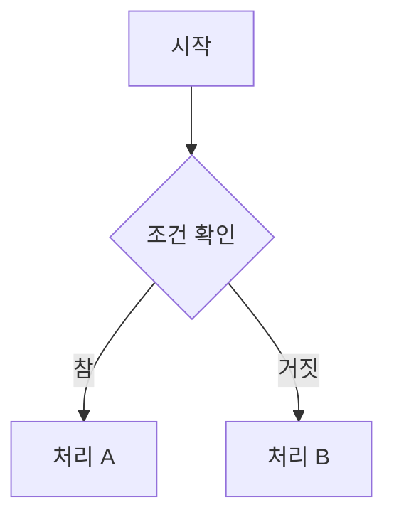

# Creative Spark V2 숏코드 레퍼런스

> **이름은 기능 이름 하나로 운영합니다(2026-10-14).** 배치 이름은 pptgen 과 같은 공용 카탈로그의 `<그룹>.<형태>`(예: `grid.cards`, `process.track`)이고,
> 모양 변형은 인수(`align`·`variant`·`connector`…)로 고릅니다. 예전 숏코드 이름(`icon-grid` 등)은 읽기 호환 별칭으로만 남아 있습니다(맨 아래 표).
> 이 문서는 cs_v2 가 직접 그리는 **28종**(구현 상태 `ready`)을 카탈로그 그룹 순서로 정리합니다. 카탈로그 전체 66종의 이름·인수: `config/library/layouts.json`.
> 변경 이력 상세: [shortcode-changelog.md](./shortcode-changelog.md)

---

## 기능 이름 — 공용 배치 카탈로그 (2026-10-14)

배치 이름은 **`<그룹>.<형태>`** 하나입니다(pptgen 과 같은 이름 — 같은 md 를 양쪽에서 빌드). 그룹은 "무엇이 주인공인가"로 정합니다.

| 그룹 | 주인공 | 이 문서의 배치 |
|------|------|------|
| 분할·카드 (`grid`) | 대등한 N개 | `grid.cards` `grid.features` `grid.badges` `grid.list` `grid.tiers` `grid.columns` |
| 비교·대조 (`compare`) | 둘의 차이 | `compare.pair` `compare.before-after` |
| 순서·흐름 (`process`) | 단계·시간·분기 | `process.track` `process.steps` `process.levels` `process.branch` |
| 구조·관계 (`structure`) | 관계 모양 | `structure.hub` `structure.rings` `structure.venn` |
| 데이터·수치 (`data`) | 숫자·위치 | `data.stats` `data.summary-bar` `data.quadrant` |
| 서술·강조 (`text`) | 한 문장·알림·요약 | `text.takeaway` `text.callout` `text.summary` `text.section` |
| 코드·터미널 (`code`) | 코드·명령 | `code.editor` `code.console` `code.command` |
| 탐색·목록 (`nav`) | 골라 보는 목록 | `nav.faq` `nav.tabs` `nav.chapters` |

이름 규칙 전체(문법·형태 어휘·새 배치 추가 절차): 공용 카탈로그 README(coding 저장소 `_templates/slide-library/catalog/README.md` 1절).

- 카탈로그에는 이 밖에도 pptgen 전용 배치(예: `process.staircase`, `structure.pillars`, `data.gauge`)가 있습니다. cs_v2 에서는 가장 가까운 숏코드로 **근사**해 그립니다(`config/library/layouts.json` 의 `impl.cs_v2.status = fallback`).
- **색 이름**(`color:`): `primary`·`secondary`·`accent`·`accent2`·`light`·`dark`·`ink`·`gray`(옛 `main`·`sub`·`deep`·`mid`·`brand` 도 동작) 또는 `#hex`. 테마를 바꾸면 그 테마 색으로 바뀝니다.
- **서식 세트**(frontmatter `shape:`): `template`(기본, 기존 모양)·`flat`·`soft`·`outline`·`elevated`·`tinted` — 카드 외곽선 굵기·그림자·둥글기·채움만 바꾸고 색은 테마를 따릅니다.
- **블록 인수 `bg=alt`**: 이 블록 카드만 보조 카드색 → 한 슬라이드에 카드 배경 2종.

```markdown
---
style: sky-blue
shape: soft
---
::: grid.cards cols=3
- icon: "⚡"
  title: "빠름"
  desc: "설명"
  color: accent
:::
::: data.stats bg=alt
- icon: "29%"
  title: "성장률"
:::
```

## 숏코드 문법 기본 규칙

```markdown
::: 숏코드명 [인수...]
- field1: "값"
  field2: "값"
- field1: "다음 항목"
  field2: "값"
:::
```

- 각 항목(`-`)은 YAML 리스트 형태로 작성합니다.
- 문자열 값은 큰따옴표(`"`)로 감쌉니다.
- `desc` 필드는 마크다운 파이프 구분(`|`)을 사용하여 내부 마크다운을 허용합니다.
- `color` 필드는 CSS 색상값 (HEX: `"#3b82f6"`, CSS 변수: `"var(--brand)"`) 형식을 사용합니다.

### 공통 선택 인수 (모든 숏코드에서 사용 가능)

| 인수 | 형식 | 예시 | 설명 |
|------|------|------|------|
| `title-size` | 숫자(비율) 또는 CSS값 | `0.9` / `1.2rem` | 해당 블록 카드 제목 크기 오버라이드 |
| `desc-size` | 숫자(비율) 또는 CSS값 | `0.85` / `14px` | 해당 블록 카드 설명 크기 오버라이드 |
| `bg` | `alt` | `bg=alt` | 이 블록 카드를 서식 세트의 보조 카드색으로 (2026-10-14) |

**비율 입력** (단위 없이 숫자만): 전역 기본값 대비 배율 (`0.9` = 기본의 90%)  
**절대값 입력** (단위 포함): 해당 값 그대로 적용 (`1.2rem`, `14px` 등)  
전역 기본값: `title-size` 기본 = `1.15rem`, `desc-size` 기본 = `0.92rem`

```markdown
# 예시: 이 nav.faq 블록만 제목을 작게
::: nav.faq title-size=0.95 desc-size=0.85rem
- title: "질문"
  desc: "답변"
:::
```

---

## 숏코드 지원 현황 요약

| 구분 | 수량 | 설명 |
|------|------|------|
| 기능 이름 (cs_v2 가 직접 그림) | **28종** | 이 문서의 각 절 — HTML·PPTX 모두 |
| 기능 이름 (근사로 그림) | **38종** | 카탈로그의 나머지(pptgen 은 직접 그림) — cs_v2 는 가장 가까운 배치로 |
| 옛 이름(읽기 호환 별칭) | 42개(cs_v2) | 새 문서에 쓰지 않음 — `npm run migrate:names` |
| 내부 특수 토큰 | **2종** | `arrow` (`process.track` 안의 화살표 항목), `slide-config` (슬라이드 설정 — `bg`/`color`/`titleSize`/`bodySize`/**`notes`**(발표스크립트 — `key: \|` 여러 줄 또는 `\n`, PPTX 노트로만 반영)) |

### 같은 배치의 모양 변형은 인수로

| 배치 | 인수 | 모양 |
|------|------|------|
| `grid.cards` | `align=center`(기본) · `left` · `row` | 아이콘 중앙 카드 / 왼쪽 아이콘 배경박스 / 아이콘+글 수평 |
| `grid.columns` | `variant=card`(기본) · `plain` | 상단 색 띠 있는 다단 카드 / 띠 없는 담백한 카드(비교용) |
| `process.track` | `connector=arrow` · `none` (`line` 은 구현 예정 — 지금은 `none` 으로 그림) | 화살표로 이은 단계 / 연결 없음(화살표는 `type: arrow` 항목) |
| `text.callout` | 첫 인수 또는 `variant=` — `tip`·`info`·`warning`·`danger`·`success` | 알림 종류 |
| 모든 배치 | `bg=alt` | 이 블록 카드를 서식 세트의 보조 카드색으로 |

```markdown
::: grid.cards align=left cols=2
- icon: "⚡"
  title: "스킬명"
  desc: "설명"
:::
```

---

## 분할·카드 (`grid`) — 관계 없는 대등한 N개를 칸·카드로 나란히

### [1] `grid.cards` — 이모지 범용 카드 격자

다목적 3단/4단 반응형 요약 카드.

**지원 필드**: `icon` (빅 이모지), `title` (대제목), `desc` (본문), `color`

```markdown
::: grid.cards
- icon: "🎨"
  title: "디자인 시스템"
  desc: "HSL 기반 테마로 일관된 색상 팔레트를 유지합니다."
:::
```

**PPTX 지원**: ✅


---

### [2] `grid.cards align=row` — 중간 체크포인트

점검 항목, 중간 검수 포인트, 체크리스트형 요약.

**지원 필드**: `icon` (체크 아이콘 이모지), `title` (항목명), `desc` (세부 설명)

```markdown
::: grid.cards align=row
- icon: "📐"
  title: "디자인 검수"
  desc: "숏코드 렌더링 결과물이 디자인 가이드에 부합하는지 확인합니다."
- icon: "🔍"
  title: "콘텐츠 검수"
  desc: "문서 내용의 정확성과 완결성을 점검합니다."
- icon: "✅"
  title: "최종 승인"
  desc: "팀 리뷰 및 게시 전 최종 확인을 완료합니다."
:::
```

**PPTX 지원**: ✅


---

### [3] `grid.cards align=left` — 스킬 / 역량 목록

인물·팀 역량, 기술 항목별 불렛 설명 카드.

**지원 필드**: `icon` (이모지), `title` (스킬명), `desc` (설명), `bullet` (불렛 리스트 문자열, 줄바꿈 구분), `color`

```markdown
::: grid.cards align=left
- icon: "⚡"
  title: "초고속 로딩"
  desc: "Vite 기반 빌드로 브라우저 첫 렌더링 최적화"
  bullet: "HMR 지원"
:::
```

**PPTX 지원**: ✅


---

### [4] `grid.features` — 대표 강점 / 기술 소개 격자

시스템 장점 나열, 핵심 아키텍처 구성 기술 목록화.

**지원 필드**: `icon` (이모지), `tag` (우측 상단 뱃지), `title` (강점 제목), `desc` (설명 본문), `color`

```markdown
::: grid.features
- icon: "⚡"
  tag: "성능"
  title: "초고속 렌더링"
  desc: "Vite 기반 빌드로 브라우저 첫 렌더링을 최적화합니다."
  color: "#f59e0b"
:::
```

**PPTX 지원**: ✅


---

### [5] `grid.badges` — 미니 스택 / 단어 뱃지 격자

기술 스택 묶음 나열, 관련 도구의 초소형 조밀 배치.

**지원 필드**: `icon` (작은 이모지), `title` (키워드/스택명), `tag` (버전/강조), `color`

```markdown
::: grid.badges
- icon: "⚛️"
  title: "React"
  tag: "v19"
- icon: "🔷"
  title: "TypeScript"
  tag: "v5"
:::
```

**PPTX 지원**: ✅


---

### [6] `grid.list` — 도구 상세 설명 요약 상자

추천 툴 목록, 개발 환경별 도구 요약 카드.  

**지원 필드**: `icon` (대표 아이콘), `title` (도구명), `desc` (슬로건), `tag` (사용처 배지), `meta` (기능 리스트, `|` 구분), `color`

```markdown
::: grid.list
- icon: "🤖"
  title: "Claude Code"
  desc: "AI 기반 터미널 개발 도우미"
  tag: "AI"
  meta: "코드 생성 | 리팩토링 | 문서화"
  color: "#8b5cf6"
:::
```

**PPTX 지원**: ✅ `md-to-pptx.mjs`


---

### [7] `grid.tiers` — 요금제 / 플랜 비교 격자

서비스 요금 요약표, 등급별 멤버십 플랜 다단 대조 비교.

**지원 필드**: `title`, `tag` (추천 뱃지), `meta` (특징 칩 목록, `|` 구분), `note` (하단 배지/가격), `featured` (`"true"` 시 강조), `color`

```markdown
::: grid.tiers
- title: "Standard"
  tag: "추천"
  meta: "HTML 변환 | PPTX 변환 | 팀 협업"
  note: "₩0"
  featured: "true"
  color: "#3b82f6"
- title: "Enterprise"
  meta: "모든 Standard 기능 | 전용 지원"
  note: "문의"
:::
```

**PPTX 지원**: ✅ `md-to-pptx.mjs`


---

### [8] `grid.columns` — 범용 다단 텍스트 단 카드

장식을 배제하고 줄글 본문 레이아웃 가독성을 높일 때.

**지원 필드**: `title` (단락 제목), `desc` (설명 본문), `note` (예시/참고란), `meta` (예시 Fallback), `color`

```markdown
::: grid.columns
- title: "개요"
  desc: "이 시스템은 마크다운 기반의 통합 가이드북 저작 도구입니다."
- title: "목표"
  desc: "HTML, 웹 슬라이드, PPTX를 단일 소스에서 동시에 생성합니다."
:::
```

**PPTX 지원**: ✅


---

### [9] `grid.columns variant=plain` — 다각도 비교 / 하단 팁박스 카드

장단점 대조, 사용자 유형별 권장 코멘트 추가.

**지원 필드**: `title` (비교 대상), `desc` (상세 비교 내용), `note` (하단 팁박스 메모), `meta` (팁박스 Fallback), `color`

```markdown
::: grid.columns variant=plain
- title: "ORM 사용"
  desc: "빠른 개발 속도와 타입 안정성을 제공합니다."
  note: "복잡한 쿼리에서는 Raw SQL 병행 사용 권장"
- title: "Raw SQL"
  desc: "세밀한 쿼리 최적화가 가능합니다."
:::
```

**PPTX 지원**: ✅


---

## 비교·대조 (`compare`) — 둘 이상을 맞대어 차이를 보임

### [10] `compare.pair` — 좌우 2단 분할 비교

두 요소의 병렬 대조 비교 (좌: Before / 우: After 방식).

**지원 필드**: `title` (대조 카드 제목), `desc` (비교 내용, 마크다운 가능), `tag` (라벨 배지), `color`

```markdown
::: compare.pair
- title: "기존 방식"
  desc: "모놀리식 서버로 모든 기능을 한 프로세스에서 처리합니다."
  tag: "Before"
  color: "#ef4444"
- title: "개선 방식"
  desc: "마이크로서비스로 독립 배포와 스케일링이 가능합니다."
  tag: "After"
  color: "#22c55e"
:::
```

**PPTX 지원**: ✅


---

### [11] `compare.before-after` — Before / After 비교

기존 방식과 개선 후 방식의 전후 차이 강조.  

**지원 필드**: `title`, `desc`, `tag`, `color`

```markdown
::: compare.before-after
- title: "기존 배포"
  desc: "수동으로 서버에 SSH 접속하여 파일을 업로드했습니다."
  tag: "BEFORE"
  color: "#ef4444"
- title: "CI/CD 자동화"
  desc: "커밋 하나로 빌드·테스트·배포가 자동 실행됩니다."
  tag: "AFTER"
  color: "#22c55e"
:::
```

**PPTX 지원**: ✅


---

## 순서·흐름 (`process`) — 단계·시간·성장·분기

### [12] `process.track connector=none` — 프로세스 흐름 시각화

단계별 프로세스, 데이터 흐름을 가로 흐름으로 표현.  

**지원 필드**: `icon`, `title` (단계명), `desc` (세부 설명), `tag` (`active` 시 강조), `color`  
**특수**: 항목 `type: "arrow"` 로 방향 화살표를 삽입합니다.

```markdown
::: process.track connector=none
- icon: "📥"
  title: "입력"
  desc: "마크다운 원고"
  tag: "active"
- type: "arrow"
- icon: "⚙️"
  title: "컴파일"
  desc: "빌드 파이프라인"
- type: "arrow"
- icon: "📄"
  title: "출력"
  desc: "HTML / PPTX"
:::
```

**PPTX 지원**: ✅


---

### [13] `process.track connector=arrow` — 가로형 연쇄 흐름도

기획 → 초안 → 디자인 → 검토 → 배포 등 마일스톤 흐름 표현.  

**지원 필드**: `icon` (단계 이모지), `title` (단계명), `meta` (활용 툴/코멘트), `color`

```markdown
::: process.track connector=arrow
- icon: "📋"
  title: "기획"
  meta: "요구사항 분석"
- icon: "✏️"
  title: "설계"
  meta: "ERD, API 명세"
- icon: "🚀"
  title: "배포"
  meta: "CI/CD 자동화"
:::
```

**PPTX 지원**: ✅


---

### [14] `process.steps` — 수직형 순서 단계 목록

튜토리얼 1단계, 2단계, 3단계의 수직 나열.

**지원 필드**: `title` (단계 요약), `desc` (상세 실행 지침), `color`

```markdown
::: process.steps
- title: "환경 설정"
  desc: "Node.js 22 이상과 pnpm을 설치합니다."
- title: "의존성 설치"
  desc: "`pnpm install` 명령으로 패키지를 설치합니다."
- title: "개발 서버 실행"
  desc: "`pnpm dev` 명령으로 로컬 서버를 시작합니다."
:::
```

**PPTX 지원**: ✅


---

### [15] `process.levels` — 레벨 스펙트럼

난이도·성숙도·역량 구간을 카드 격자로 비교.  
`tag: "highlight"` 로 특정 카드를 강조합니다.

**지원 필드**: `title` (레벨명), `desc` (설명), `color` (선택), `tag` (`highlight` 시 강조 카드)

```markdown
::: process.levels
- title: "입문"
  desc: "기본 문법과 핵심 개념 이해"
- title: "중급"
  desc: "실무 프로젝트 적용 가능"
  tag: "highlight"
- title: "고급"
  desc: "아키텍처 설계 및 최적화 수행"
:::
```

**PPTX 지원**: ✅


---

### [16] `process.branch` — 깃 플로우 브랜치 흐름 시각화

Git 브랜치 전략, 브랜치 흐름을 시각화.  

**지원 필드**: `title` (브랜치명), `desc` (브랜치 용도), `tag` (브랜치 타입: `main`/`dev`/`feature`/`release`/`hotfix`), `color`

```markdown
::: process.branch
- title: "main"
  desc: "운영 배포 브랜치"
  tag: "main"
- title: "develop"
  desc: "통합 개발 브랜치"
  tag: "dev"
- title: "feature/auth"
  desc: "로그인 기능 개발"
  tag: "feature"
:::
```

**PPTX 지원**: ✅


---

## 구조·관계 (`structure`) — 중심-주변, 기반-기둥, 포함, 교집합, 그룹

### [17] `structure.hub` — 네트워크 / 레이어 박스 다이어그램

인프라 레이어, 네트워크 구조 계층을 박스로 시각화.

**지원 필드**: `title` (레이어명), `desc` (구성 요소 설명), `tag` (레이어 유형 배지), `color`

```markdown
::: structure.hub
- title: "Client Layer"
  desc: "React SPA, Mobile App"
  tag: "Frontend"
  color: "#3b82f6"
- title: "API Gateway"
  desc: "Load Balancer, Rate Limiting"
  tag: "Infra"
:::
```

**PPTX 지원**: ✅


---

### [18] `structure.rings` — 동심원 포함관계

A⊃B⊃C 같은 계층적 포함관계. 항목은 바깥(가장 큰 범주)에서 안쪽(가장 구체적인 범주) 순서로 작성.

**지원 필드**: `title`(범주명), `color`, `icon`(마지막 항목에만 — 중심 아이콘)

```markdown
::: structure.rings
- title: "AI"
  color: "#94A3B8"
- title: "머신러닝"
  color: "#64748B"
- title: "딥러닝"
  color: "#475569"
- title: "LLM"
  icon: "🧠"
  color: "#1E293B"
:::
```

**PPTX 지원**: ✅


---

### [19] `structure.venn` — 벤 다이어그램

두 영역이 겹칠 때 새로운 가치/의미가 발생함을 표현. **alias**: `venn`

**지원 필드**: 항목 3개 고정 순서 — `[0]` 왼쪽 원(`title`, `color`), `[1]` 오른쪽 원(`title`, `color`), `[2]`(선택) 교집합 캡션(`icon`, `desc`)

```markdown
::: structure.venn
- title: "전공 A"
  color: "#6366F1"
- title: "전공 B"
  color: "#EC4899"
- icon: "⭐"
  desc: "새로운 가치"
:::
```

**PPTX 지원**: ✅


---

## 데이터·수치 (`data`) — 숫자·비율·위치가 주인공

### [20] `data.stats` — 수치 지표 / 핵심 데이터 카드

"33% 성능 향상", "₩0 비용" 등 거대한 지표 표현.

**지원 필드**: `icon` (또는 `title` — 거대 수치), `title` (수치 라벨), `desc` (참조 노트), `color`

```markdown
::: data.stats
- icon: "99.9%"
  title: "가동률"
  desc: "지난 12개월 기준"
- icon: "2K"
  title: "지원 해상도"
:::
```

**PPTX 지원**: ✅


---

### [21] `data.summary-bar` — 하단 지표 요약 수치 그리드

챕터 분석 완료 후나 문서 하단에 수치 하이라이트를 다크 띠로 표현.

**지원 필드**: `icon` (요약 수치 및 단위), `title` (수치 라벨)

```markdown
::: data.summary-bar
- icon: "25종"
  title: "정식 숏코드"
- icon: "38종"
  title: "alias 포함 지원 규격"
- icon: "3종"
  title: "출력 포맷"
:::
```

**PPTX 지원**: ✅


---

### [22] `data.quadrant` — 사분면 위치 차트

두 축(X/Y) 기준으로 여러 항목의 상대 위치를 비교. 축 라벨은 블록 인수로 지정.

**지원 필드**: 블록 인수 `xLabel="..."` `yLabel="..."` (공백 포함 시 큰따옴표 필수) · 항목 `title`(포인트 라벨), `color`, `fx`/`fy`(0~1 비율, 좌하단이 0,0)

```markdown
::: data.quadrant xLabel="가격" yLabel="품질"
- title: "제품 A"
  fx: "0.3"
  fy: "0.7"
  color: "#6366F1"
- title: "제품 B"
  fx: "0.8"
  fy: "0.2"
  color: "#EC4899"
:::
```

**PPTX 지원**: ✅


---

## 서술·강조 (`text`) — 한 문장·인용·알림·요약이 주인공

### [23] `text.takeaway` — Key Takeaway 배너

섹션 마무리 핵심 메시지를 풀 와이드 배너로 강조.  

**지원 필드**: `title` (핵심 문장), `desc` (부연 설명), `color`

```markdown
::: text.takeaway
- title: "단일 소스, 다중 출력"
  desc: "마크다운 원고 하나로 HTML·슬라이드·PPTX를 동시에 생성합니다."
  color: "#3b82f6"
:::
```

**PPTX 지원**: ✅


---

### [24] `text.callout` — 강조 알림 박스

중요 경고, 팁, 참고 사항 등을 강조 배경으로 표현.

**지원 필드**: `title` (알림 제목), `desc` (본문), `tag` (배지: `warning`/`info`/`tip`/`note`), `color`

```markdown
::: text.callout
- title: "⚠️ 주의 사항"
  desc: "이 설정을 변경하면 기존 데이터가 초기화될 수 있습니다."
  tag: "warning"
  color: "#f59e0b"
:::
```

**PPTX 지원**: ✅


---

### [25] `text.summary` — 핵심 내용 요약 박스

챕터 후반부에 핵심 요점을 정리하는 카드.  

**지원 필드**: `title` (요약 대제목), `desc` (요약 본문, 마크다운 가능), `meta` (부연 설명 또는 칩 리스트)

```markdown
::: text.summary
- title: "핵심 요약"
  desc: "숏코드 시스템을 활용하면 마크다운 단일 소스에서 HTML, 웹 슬라이드, PPTX를 동시에 생성할 수 있습니다."
  meta: "25종 숏코드 | HTML 연동 | PPTX 연동"
:::
```

**PPTX 지원**: ✅


---

### [26] `text.section` — Part 구분 표지 배너

대형 Part/Chapter 전환 구분 슬라이드 또는 섹션 헤더.  

**지원 필드**: `title` (Part 제목), `desc` (부제 또는 설명), `tag` (Part 번호 배지), `color`

```markdown
::: text.section
- title: "Part 2. 실무 활용 패턴"
  desc: "실제 프로젝트에서 즉시 사용 가능한 숏코드 조합 패턴을 학습합니다."
  tag: "PART 02"
  color: "#8b5cf6"
:::
```

**PPTX 지원**: ✅


---

## 코드·터미널 (`code`) — 코드·명령·실행 결과

### [27] `code.editor` — 코드 에디터 스타일 박스

코드 편집기 UI 형태로 코드 블록을 감싸 표현.

**지원 필드**: `title` (파일명/탭명), `desc` (코드 또는 설명 본문, 마크다운 가능)

```markdown
::: code.editor
- title: "app.ts"
  desc: |
    ```typescript
    const app = express();
    app.listen(3000);
    ```
:::
```

**PPTX 지원**: ✅


---

### [28] `code.console` — 터미널 콘솔 출력 박스

다크 배경 터미널 스타일로 CLI 출력을 표현.

**지원 필드**: `title` (세션/프롬프트 라벨), `desc` (콘솔 출력 내용)

```markdown
::: code.console
- title: "$ npm run build"
  desc: |
    ✓ 빌드 완료 (2.3s)
    dist/index.html  42 kB
:::
```

**PPTX 지원**: ✅


---

### [29] `code.command` — Windows 명령 프롬프트 박스

Windows cmd 스타일의 커맨드 실행 표현.

**지원 필드**: `title` (명령어 또는 라벨), `desc` (실행 결과)

```markdown
::: code.command
- title: "pip install -r requirements.txt"
  desc: "패키지 설치 완료. Successfully installed 12 packages."
:::
```

**PPTX 지원**: ✅


---

## 탐색·목록 (`nav`) — 목차·탭·질문답변처럼 문서를 훑게 하는 목록

### [30] `nav.faq` — FAQ 아코디언 목록

자주 묻는 질문 / 답변 형식의 접이식 목록.

**지원 필드**: `title` (질문), `desc` (답변, 마크다운 가능)

```markdown
::: nav.faq
- title: "숏코드와 일반 마크다운을 혼용할 수 있나요?"
  desc: "네, 문서 내 어디서나 자유롭게 혼용 가능합니다. 숏코드 블록 밖의 마크다운은 표준 방식으로 렌더링됩니다."
- title: "PPTX로 변환이 안 되는 숏코드가 있나요?"
  desc: "25종 정식 숏코드 + 13종 alias 전체가 PPTX 렌더러를 갖추고 있어 변환 시 슬라이드가 누락되지 않습니다."
:::
```

**PPTX 지원**: ✅


---

### [31] `nav.tabs` — OS / 플랫폼 탭 전환 목록

Windows / macOS 등 플랫폼별 조치 방법 탭 안내.

**지원 필드**: `title` (탭/플랫폼 이름), `desc` (해당 플랫폼 내용, 마크다운 가능)

```markdown
::: nav.tabs
- title: "Windows"
  desc: "`winget install Git.Git` 명령을 관리자 터미널에서 실행합니다."
- title: "macOS"
  desc: "`brew install git` 명령을 Terminal에서 실행합니다."
:::
```

**PPTX 지원**: ✅


---

### [32] `nav.chapters` — 시리즈 세부 챕터 목록

Part 하위의 챕터 번호·제목·설명·구분 배지 목록화.

**지원 필드**: `icon` (챕터 번호 문자열), `title` (챕터 제목), `desc` (세부 설명), `tag` (구분 배지: `개념`/`도구`/`사례`/`가이드`/`실습`/`주의`/`핵심`)

```markdown
::: nav.chapters
- icon: "01"
  title: "시스템 개요"
  desc: "전체 아키텍처와 핵심 구성 요소를 소개합니다."
  tag: "개념"
- icon: "02"
  title: "빠른 시작 가이드"
  desc: "설치부터 첫 빌드까지 단계별로 안내합니다."
  tag: "실습"
:::
```

**PPTX 지원**: ✅


---

## 옛 이름(읽기 호환 별칭) → 기능 이름

이름은 **기능 이름 하나로 운영**합니다. 아래 옛 이름은 예전 문서를 읽기 위한 별칭일 뿐이고, 빌드는 받는 즉시 오른쪽 이름 + 인수로 바꿔 그립니다(출력 같음).
새 문서에는 쓰지 않습니다. 남은 옛 이름은 `npm run migrate:names -- <경로>` 로 한 번에 바꿉니다(`--check` 로 확인만). 빌드 CLI 는 옛 이름을 만나면 경고를 한 줄 남깁니다.

| 옛 이름 | 기능 이름 + 인수 |
|---|---|
| `alert-box` | `text.callout` |
| `badge-grid` | `grid.badges` |
| `before-after` | `compare.before-after` |
| `bottom-list` | `text.summary` |
| `chapter-list` | `nav.chapters` |
| `checkpoint-grid` | `grid.cards align=row` |
| `cmd-box` | `code.command` |
| `columns-grid` | `grid.columns` |
| `compare-before-after` | `compare.before-after` |
| `compare-diff` | `compare.before-after` |
| `compare-grid` | `grid.columns variant=plain` |
| `compare-split` | `compare.pair` |
| `concentric-rings` | `structure.rings` |
| `console-box` | `code.console` |
| `editor-box` | `code.editor` |
| `faq-list` | `nav.faq` |
| `feature-grid` | `grid.features` |
| `flow` | `process.track connector=none` |
| `git-flow` | `process.branch` |
| `git-flow-strip` | `process.branch` |
| `icon-grid` | `grid.cards` |
| `level-grid` | `process.levels` |
| `network-box` | `structure.hub` |
| `os-tabs` | `nav.tabs` |
| `part-banner` | `text.section` |
| `part-deck` | `text.section` |
| `plan-grid` | `grid.tiers` |
| `quadrant-chart` | `data.quadrant` |
| `skill-list` | `grid.cards align=left` |
| `stat-grid` | `data.stats` |
| `step-flow` | `process.track connector=none` |
| `step-list` | `process.steps` |
| `summary-bar` | `data.summary-bar` |
| `summary-box` | `text.summary` |
| `takeaway` | `text.takeaway` |
| `takeaway-banner` | `text.takeaway` |
| `tool-box` | `grid.list` |
| `tool-list` | `grid.list` |
| `venn` | `structure.venn` |
| `venn-diagram` | `structure.venn` |
| `workflow-flow` | `process.track connector=arrow` |
| `workflow-strip` | `process.track connector=arrow` |

pptgen 옛 구현 ID(`staircase`·`hub-spoke`·`c01-p07` 등)도 같은 방식으로 받습니다 — 전체 표는 공용 카탈로그 `config/library/layouts.json` 의 `aliases`·`alias_args`.

---

## HTML·PPTX 지원 현황

cs_v2 구현 상태가 `ready` 인 배치(이 문서의 각 절)는 HTML·PPTX 모두 그립니다(`src/__tests__/` 커버리지 테스트가 잠금). 그 밖의 카탈로그 배치는 가장 가까운 배치로 **근사**합니다.

| 그룹 | ready (HTML·PPTX) | 근사(fallback) |
|---|---|---|
| 분할·카드 | `grid.cards` `grid.features` `grid.badges` `grid.list` `grid.tiers` `grid.columns` | `grid.main-plus-3` `grid.cards-icon-3` `grid.wide-narrow-titled` `grid.narrow-wide-titled` `grid.box-1` `grid.box-2` `grid.box-3` `grid.box-4` `grid.narrow-wide` `grid.wide-narrow` `grid.circle-3` `grid.band-box-3` |
| 비교·대조 | `compare.pair` `compare.before-after` | `compare.main-sub` `compare.balance` `compare.hbars` `compare.pair-summary` |
| 순서·흐름 | `process.track` `process.steps` `process.levels` `process.branch` | `process.staircase` `process.growth` `process.cycle-3` `process.zigzag` `process.cards-arrow-4` `process.input-circles-4` `process.band-columns-3` `process.steps-checklist-3` |
| 구조·관계 | `structure.hub` `structure.rings` `structure.venn` | `structure.pillars` `structure.groups-2x3` |
| 데이터·수치 | `data.stats` `data.summary-bar` `data.quadrant` | `data.bars` `data.gauge` |
| 서술·강조 | `text.takeaway` `text.callout` `text.summary` `text.section` | `text.statement` `text.body` `text.quote` `text.icon-statement` `text.avatar` |
| 코드·터미널 | `code.editor` `code.console` `code.command` | - |
| 탐색·목록 | `nav.faq` `nav.tabs` `nav.chapters` | - |
| 이미지 혼합 | - | `media.cards-image` `media.banner` `media.full` |
| 견본 | - | `sample.chart-pair` `sample.infographic-2` |

---

## Mermaid 구조도 지원 (2026-09 추가)

숏코드(`::: type`)가 아니라 표준 마크다운 fenced code block으로 사용한다. 절차·구조를 다이어그램으로 정확히 보여줘야 하고 위 숏코드 카탈로그로 표현이 안 될 때 사용.

````markdown

````

* **가이드 HTML·프레젠테이션 HTML**: `mermaid.js`(jsdelivr CDN)를 `<head>`에서 로드해 브라우저에서 실제 다이어그램(SVG)으로 렌더링. 가이드는 `theme:"default"`(라이트), 프레젠테이션은 `theme:"dark"`로 고정 — 프레젠테이션의 라이트/다크 토글 버튼을 눌러도 다이어그램 자체 테마는 바뀌지 않는다(알려진 제약).
* **PPTX**: 전용 렌더러가 없다. 기존 코드블록 렌더링 경로를 그대로 타서 **원문 mermaid 문법이 다크 코드박스 안에 텍스트로 표시**된다(다이어그램 이미지로 변환되지 않음). 실제 이미지가 필요하면 `mmdc`(mermaid-cli)로 PNG를 만들어 이미지로 첨부하는 별도 작업이 필요하다.
