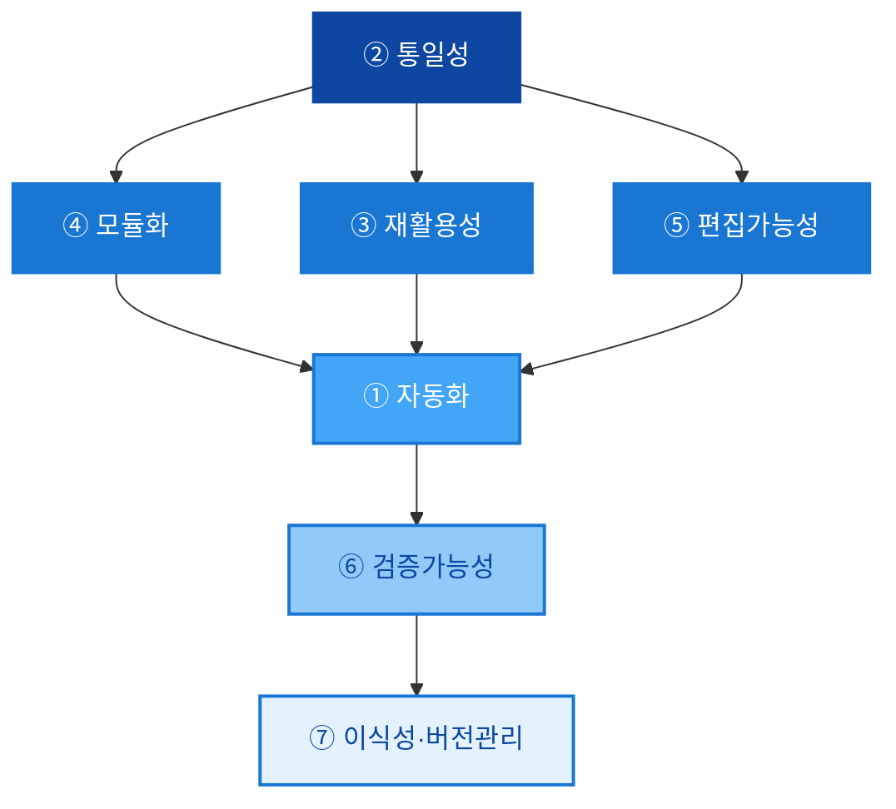
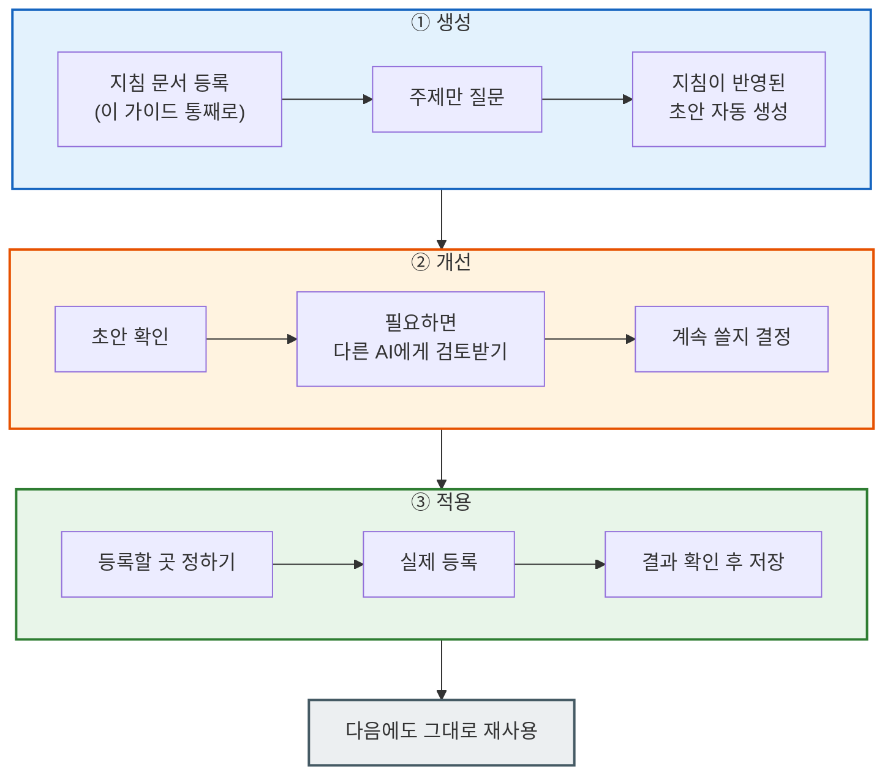

# 1. AI 플랫폼 3대 접근 채널 (웹·데스크탑·CLI)

대부분의 AI 어시스턴트(예: Claude, ChatGPT, Gemini)는 접근 방식에 따라 세 가지 형태로 구분. 목적에 맞는 진입 채널 선택이 첫 번째 단계.

## 웹·데스크탑·CLI 3대 접근 채널 비교

::: grid.columns cols=3
- title: "웹 브라우저"
  desc: "브라우저에서 즉시 사용. 가장 쉬운 진입 방법으로 별도 설치 없이 로그인만 하면 됨. 아티팩트·프로젝트·커넥터 등 주요 기능을 모두 UI로 조작."
  meta: "설치 불필요|결과물 미리보기(아티팩트/캔버스)|프로젝트·커넥터 지원|파일 첨부·음성 입력"
- title: "데스크탑 전용 앱"
  desc: "Mac / Windows 전용 앱. 웹과 동일한 계정으로 사용하지만 외부 도구 연결(MCP 등)이 핵심 차이점. 로컬 파일 시스템, Notion, GitHub 등 외부 서비스를 직접 제어."
  meta: "외부 도구 연결(MCP)|로컬 파일 접근|파일 드래그앤드롭|단축키로 즉시 호출"
- title: "CLI 에이전트"
  desc: "터미널에서 실행하는 에이전틱 코딩 도구(예: Claude Code, Cursor, Codex). 파일을 읽고 수정하고, 테스트를 실행하며, Git을 조작하는 자율적 방식으로 동작. 개발자 전용 환경."
  meta: "npm install -g로 설치|파일 자동 수정|터미널 명령 실행|프로젝트 지침 파일 참조"
:::

::: compare.pair
- title: "웹 & 데스크탑 앱"
  desc: "넓은 모니터 화면에서 대용량 문서를 업로드하고, 사이드 패널에 결과물을 즉석 렌더링하며 복잡한 프롬프트 엔지니어링을 수행하는 주력 작업 공간."
  meta: "아티팩트/캔버스 독립창 렌더링|대용량 문서(PDF, CSV) 및 프로젝트 관리|지침(시스템 프롬프트) 사전 설계|단축키를 활용한 창 전환"
  note: "기획서 집필, 소스 데이터 분석, 업무 서식 디자인 작업에 최적"
- title: "모바일 앱"
  desc: "기동성을 극대화하여 이동 중에 음성으로 즉각 질문을 던지거나, 카메라로 영수증·안내문·회의판 손글씨를 실시간 촬영해 즉각적인 분석을 유도하는 보조 제어 환경."
  meta: "카메라 실시간 이미지 업로드|햅틱 인터페이스 및 음성 인식 질의|언제 어디서나 연동 내역 조회|현장 정보 및 회의 메모 즉석 첨부"
  note: "외출 시 모니터링, 단발성 아이디어 질의, 실시간 현장 분석에 최적"
:::

---

## 구독 플랜 구조 — 일반화된 4단계

플랫폼마다 이름은 다르지만 대개 비슷한 4단계 구조(예: Claude Free/Pro/Max/Team, ChatGPT Free/Plus/Pro/Team, Gemini 무료/Advanced/Ultra 등).

::: grid.tiers cols=4
- title: "무료"
  tag: "체험"
  meta: "하루 제한 메시지|기본 모델|기본 기능"
  desc: "$0 / 월"
- title: "개인 유료"
  tag: "추천"
  meta: "더 많은 메시지(시간 단위 리셋)|상위 모델 선택 가능|프로젝트 기능|확장 사고 모드"
  desc: "$20 / 월 내외"
  featured: "true"
- title: "헤비유저"
  tag: "Power User"
  meta: "5~20배 더 많은 사용량|우선 처리|API 연동 최적화"
  desc: "$100~200 / 월 내외"
- title: "팀 / 엔터프라이즈"
  tag: "조직"
  meta: "관리자 콘솔|데이터 비학습 보장|SSO 지원"
  desc: "별도 문의"
:::

---

## 웹 사용 핵심 설정 4가지

플랫폼마다 위치는 다르지만, 프로필 아이콘이나 설정(Settings) 메뉴에서 아래 4가지 반드시 확인.

::: grid.columns cols=2
- title: "이름 · 기본 지침"
  desc: |
    - 이름 필드: AI가 나를 부를 이름 입력
    - "나에 대해 알아둘 점": 직업·관심사·언어 선호
    - "응답 스타일": 어조·형식 고정
  meta: "저장 즉시 신규 대화부터 반영|프로젝트별 지침과 충돌 시 프로젝트 지침이 우선"
- title: "사용량 확인"
  desc: |
    - 계정/사용량 메뉴에서 현재 사용량·남은 양 확인
    - 대부분 일정 시간 단위로 리셋
    - 상위 플랜일수록 더 넉넉한 풀 제공
  meta: "사용량 초과 시 속도 저하 또는 차단|상위 플랜 업그레이드로 해결"
- title: "커넥터(외부 서비스 연결)"
  desc: |
    - 설정 → 연결(Integrations/Connectors) 메뉴
    - 각 서비스 옆 Connect 버튼 클릭
    - OAuth 인증 → 권한 허용 → 연결 완료
  meta: "Google Drive · Gmail · Calendar 등 다수 지원|연결 해제도 같은 메뉴에서 가능"
- title: "CLI 연동"
  desc: |
    - CLI 에이전트 설치 후 웹 계정과 자동 연동되는 경우가 많음
    - 웹 세션과 CLI 세션 동기화 여부 설정
    - 프로젝트 단위 연동 옵션 제공
  meta: "설치 명령 예: npm install -g @anthropic-ai/claude-code|터미널에서 실행 후 브라우저 인증"
:::

---

# 2. 좋은 지침 설계 — 역할·맥락·형식·제약 4요소

효과적인 지침(프롬프트)은 **역할 + 맥락 + 형식 + 제약** 네 가지를 모두 포함. 이 절에서는 기본 4요소부터 확장판 5요소, 깊게 생각시키는 기법, 대화 진행법, 나만의 정보 프로필, 설계 7대 원칙, 그리고 이 지침을 실제로 만들고 적용하는 3단계 프로세스까지 다룸.

## 기본 4요소

::: grid.features cols=4
- icon: "👤"
  title: "역할 (Persona)"
  tag: "누구로 행동할지"
  desc: "\"너는 10년 경력의 UX 라이터야. 기술 문서를 일반인도 쉽게 읽도록 바꿔줘.\""
- icon: "🗺️"
  title: "맥락 (Context)"
  tag: "배경 정보"
  desc: "\"우리 서비스는 40~60대 직장인 대상 건강관리 앱이야. 사용자들은 IT에 익숙하지 않아.\""
- icon: "📄"
  title: "형식 (Format)"
  tag: "출력 형태"
  desc: "\"결과는 마크다운 표로 정리하고, 각 항목에는 예시를 하나씩 포함해줘.\""
- icon: "🚫"
  title: "제약 (Constraint)"
  tag: "하지 말아야 할 것"
  desc: "\"전문 의학 용어는 쓰지 마. 영어는 괄호 안에만 병기해.\""
:::

## 확장판 — 프롬프트에 들어가야 할 5가지

명확한 응답을 유도하려면 프롬프트는 아래 5가지 요소를 포함해야 함. 위 4요소의 "역할·맥락·형식"에 **예시(Examples)**가 더해진 형태로 이해.

::: grid.cards align=left
- icon: "🎯"
  title: "지시 (Instruction)"
  desc: "AI가 수행할 주요 작업과 핵심 목표를 구체적이고 간결하게 명시."
- icon: "🗺️"
  title: "맥락 (Context)"
  desc: "작업의 배경 정보나 상황을 제공해 의도에 맞는 관련성 높은 응답을 유도."
- icon: "👤"
  title: "역할 (Role)"
  desc: "AI에게 분야별 전문가·컨설턴트 같은 특정 역할을 부여해 전문성과 문제 해결 성능을 향상."
- icon: "💡"
  title: "예시 (Examples)"
  desc: "복잡하거나 모호한 작업일수록 원하는 출력 사례(Q&A 쌍 등)를 제공해 패턴 학습."
- icon: "📄"
  title: "형식 (Formatting)"
  desc: "결과물 포맷(마크다운, JSON, 표, 불릿 등)을 명확히 지정. XML 태그와 마크다운 문법 적극 활용."
:::

## 깊게 생각하게 만드는 방법 — CoT & ToT

::: grid.features cols=4
- icon: "🪜"
  title: "단계별로 생각하기 (CoT)"
  tag: "Chain of Thought"
  desc: "\"단계별로 생각해서 답변해줘\"라고 지시해 AI가 바로 답을 내지 않고 충분히 생각할 공간 확보."
- icon: "🌳"
  title: "여러 갈래로 따져보기 (ToT)"
  tag: "Tree of Thought"
  desc: "한 가지 방법만 보지 않고 가능한 방법 여러 개를 나열한 뒤 각각 장단점을 비교해서 선택."
- icon: "🔁"
  title: "여러 번 생각해서 답 고르기"
  tag: "Self-consistency"
  desc: "같은 문제를 다른 방식으로 최소 2번 이상 풀어보게 한 뒤, 가장 일관되고 그럴듯한 답 선택."
- icon: "📌"
  title: "근거를 밝히게 하기"
  tag: "Grounding"
  desc: "결론만 내지 말고, 왜 그렇게 판단했는지(출처·데이터·논리)를 반드시 함께 명시."
:::

## 대화 진행 방법

앞서 다룬 "지침(4·5요소)"이 프로젝트에 한 번 등록해두는 **고정 설정**이라면, 여기서 다루는 건 지침이 있든 없든 **한 번의 요청을 여러 턴에 걸쳐 다듬어가는 전략**임. 한 번에 완벽한 프롬프트를 쓰려 하지 말고, 대화를 나눠서 단계적으로 원하는 결과에 수렴.

::: process.steps
- title: "넓게 뽑고 → 좁혀서 다듬기"
  desc: "먼저 아이디어를 여러 개 넓게 뽑아내고, 그중 하나를 골라 자세히 다듬는 식으로 프롬프트를 두 번에 나눠 연결. 예: 1턴 \"블로그 주제 아이디어 10개만 던져줘\" → 2턴 \"3번이 좋다, 이걸로 목차까지 짜줘\"."
- title: "미리 채우기"
  desc: "AI가 답변을 시작할 첫 문장을 사용자가 미리 지정. 예: \"다음 문장으로 시작해서 이어 써줘 — '결론부터 말하면, 이 계약은 체결하지 않는 게 낫습니다.'\" (서론이 늘어지는 걸 막고 원하는 톤으로 바로 유도)"
- title: "다시 쓰기"
  desc: "\"이런 기준으로 고쳐줘\"처럼 명확한 평가 기준을 주고 다시 쓰게 해서, 여러 번에 걸쳐 품질 향상. 예: 그냥 \"다시 써줘\" 대신 \"문장을 더 짧게, 전문용어는 풀어서, 결론을 첫 줄로 옮겨서 다시 써줘\"."
:::

## 나에 대한 정보 미리 알려주기 — 내 정보 프로필

매번 내 상황을 새로 설명하지 않으려면, 아래 세 가지를 미리 정리해서 프롬프트 앞부분이나 시스템 지침에 미리 등록. 이렇게 등록해 둔 "내 정보 세트"를 **내 정보 프로필**이라 지칭.

::: grid.columns cols=3
- title: "누구인지"
  desc: "직업, 주로 다루는 분야, 얼마나 익숙한지(초보/전문가)를 사전 공유."
- title: "어떤 결과물을 원하는지"
  desc: "완성된 글 vs 간단한 개요, 답변 길이, 원하는 출력 형태를 명시."
- title: "어떤 말투를 원하는지"
  desc: "전문적인 말투인지 편한 말투인지, 반대 의견도 듣고 싶은지 명시."
:::

## 프롬프트/스킬 설계 원칙 — 7대 원칙

기본 5원칙(자동화·통일성·재활용성·모듈화·편집가능성)에, 실제 스킬 운영에서 검증된 두 가지(검증가능성·이식성)를 더해 7개로 확장.

| # | 원칙 | 쉽게 말하면 | 실무 적용 예 |
|---|---|---|---|
| ① | **자동화** | 사람이 매번 손대지 않아도 처음부터 끝까지 순서대로 이어져서 결과가 나옴 | 문서 변환: `분석 → 읽기 → 설정 불러오기 → 조립 → 확인` |
| ② | **통일성** | 위치·글꼴·색 같은 기준이 항상 똑같이 적용됨 | 슬라이드/문서 템플릿의 설정 파일, 마스터 슬라이드 |
| ③ | **재활용성** | 한 번 만든 걸 조건만 바꿔서 계속 써도 품질이 유지됨 | 스킬의 실행 조건 + 바꿔 쓸 수 있게 만든 지침 |
| ④ | **모듈화** | 전체를 한 번에 만들지 않고, 작은 조각으로 나눠서 조립해서 씀 | 역할별로 나뉜 스킬(예: 데이터 수집 스킬 → 문서 조립 스킬) |
| ⑤ | **편집가능성** | 기준(마스터/설정) 하나만 고치면 전체 결과물에 한 번에 반영됨 | 문서 마스터 편집, 설정값만 바꾸면 전체가 바뀌는 구조 |
| ⑥ | **검증가능성**(신규) | 결과가 맞는지 확인하는 절차가 따로 있음 | 결과 확인 게이트 통과, 승인 없이는 다음 단계로 못 넘어가는 규칙 |
| ⑦ | **이식성·버전관리**(신규) | 같은 지침을 다른 AI로 옮겨도 그대로 쓸 수 있고, 몇 번째 수정본인지 표시해 둠 | 스킬 버전 v1/v2/v3 표시, 스킬 파일로 묶어서 저장 |

⑥⑦이 필요한 이유: ①~⑤는 "결과물을 어떻게 잘 만들 것인가"에 관한 원칙. ⑥은 "만든 결과가 실제로 맞는지 어떻게 확인하는가", ⑦은 "이 지침을 다른 AI로 옮겨도 똑같이 작동하는가"를 다룸. 여러 AI 플랫폼을 함께 쓰는 경우, ⑦이 없으면 같은 지침을 도구마다 새로 제작해야 함.

7개 원칙은 나열식이 아니라 **의존 관계**. "통일성"이라는 기준선이 먼저 있어야 "모듈화·재활용성·편집가능성"이 의미를 갖고, 이 세 가지가 갖춰져야 비로소 "자동화"가 가능해지며, 자동화된 결과는 "검증가능성"으로 신뢰를 확인받고, 마지막으로 "이식성·버전관리"를 통해 다른 플랫폼/다음 버전으로 연결.

---

## 실전 지침 예시 3종

프로젝트 지침(웹) 또는 CLAUDE.md 같은 프로젝트 지침 파일(CLI)에 고정하여, 대화방들이 일관성 있게 행동하게 만드는 특화 지침 템플릿. 4요소가 실제로 어떻게 조합되는지 보여주는 예시.

::: grid.columns cols=3
- title: "① 도서 요약 및 독서 모임 가이드"
  desc: "긴 텍스트를 구조화하고 토론 질문 도출."
  meta: "[역할] 독서 토론 모임의 전문 모더레이터이자 서평가. [출력 형식] 도서의 핵심 요약(주제, 타겟층, 찬반 논점)을 계층 구조로 정리하고, 참가자들이 활발히 논의할 질문 3가지를 매번 도출할 것. [제약] 줄거리를 나열하기보다 저자의 핵심 주장과 한계점에 초점을 맞출 것."
- title: "② 비즈니스 이메일 톤 조율사"
  desc: "원하는 의도를 정중하고 매끄러운 격식체로 변환."
  meta: "[역할] 20년 경력의 대기업 비서실 소속 커뮤니케이션 전문가. [출력 형식] 감정 섞인 문구나 조각난 지시사항을 분석해 격식 있는 이메일 양식(인사말, 본문 핵심사항, 맺음말)으로 3가지 버전(표준형, 제안형, 협상형)을 제시할 것."
- title: "③ 개인 맞춤 건강 및 피트니스 코치"
  desc: "식단과 운동 이력을 분석해 현실적인 제안 제공."
  meta: "[역할] 예방 의학 지식을 겸비한 전문 스포츠 영양사 및 트레이너. [출력 형식] 일일 식사 일지와 운동 강도를 분석해 영양소 섭취 균형 비율(탄단지) 피드백과 개선이 필요한 식습관 팁 2가지를 제공할 것. [제약] 극단적인 굶기나 약물 권장 조언은 철저히 배제할 것."
:::

---

## 지침 만드는 과정 — 생성 → 개선 → 적용

- **이 절의 원칙들을 매번 사람이 손으로 체크하는 게 아니라, AI에게 지침으로 미리 등록.**
- 이후에는 주제만 던져도 AI가 이 지침(5대 구성요소, CoT/ToT, 7대 원칙)에 맞춰 초안 생성.
- 흐름은 **"생성(지침 기반으로 바로 만들기) → 개선(사람이 다듬기) → 적용(실제로 등록해서 계속 쓰기)"** 3단계.

3단계(적용) 결과가 마음에 안 들면 2단계(개선)로 되돌아가 재조정.

## 어디에 등록해서 쓸까 — 플랫폼별 적용 방법

같은 지침이라도 도구마다 등록 방식이 다름. "③ 적용" 단계를 실제로 어디에 넣을지 정리.

::: grid.columns cols=3
- title: "Claude"
  desc: "프로젝트(대화창 상단에 기본 지침·참고 파일을 걸어두는 기능) / 스킬(지침+스크립트를 하나로 묶어 등록, 자동화·조각화까지 필요할 때 적합) / CLI+스크립트(정해진 코드대로만 똑같이 처리, 편집가능성이 중요한 반복 작업에 적합)."
  meta: "프로젝트: 가볍게 개인화만|스킬: 자동화·검증까지 필요할 때|CLI+스크립트: 매번 정확히 똑같이 반복돼야 하는 작업"
- title: "Gemini"
  desc: "Gems(짧은 지침을 등록해두는 기능, 통일성·재활용성은 확보되지만 조각화는 어려움) / Notebook(올려둔 자료를 근거로 답변, Gems 결과를 자료로 쌓아 반복 개선)."
  meta: "Gems: 역할+출력 규칙 등록|Notebook: 자료 기반 반복 개선"
- title: "ChatGPT"
  desc: "Custom GPT / Projects — 지침+참고파일 등록. 다른 플랫폼의 '프로젝트'와 비슷하지만, 코드를 묶어 자동 실행시키는 '스킬' 같은 기능은 상대적으로 약함."
  meta: "Custom GPT: 역할·지침 고정|Projects: 참고파일 공유"
:::

::: text.callout tip
- title: "등록 전 마지막 확인"
  desc: |
    지침이 7대 원칙을 다 만족하는가
    예시가 최소 1개는 들어있는가
    결과가 맞는지 확인하는 절차가 있는가
    몇 번째 수정본인지 표시했는가(v1, v2…)
    다른 도구로 옮길 때 고쳐야 할 부분이 따로 표시돼 있는가
:::

---

# 3. 재사용 가능한 스킬 파일 패턴

## 단편적 질답 vs 구조화된 접근

::: grid.columns cols=2
- title: "단편적 질답 방식"
  desc: "매번 맥락을 처음부터 설명. 대화가 끝나면 패턴 소멸. AI에게 설명하는 시간이 전체 작업의 절반을 차지."
  meta: "매 세션 맥락 재설명 필요|결과 품질이 일관되지 않음|다른 팀원이 재현 불가|패턴이 축적되지 않음"
- title: "구조화된 재사용 방식"
  desc: "스킬 파일과 시스템 프롬프트로 맥락을 파일에 저장. 한 번 만든 지침이 모든 세션에 자동 적용."
  meta: "지침 파일 한 번 작성으로 영구 재사용|팀원 모두가 동일 품질 재현|프로젝트 간 이식 가능|점진적으로 지침 품질 향상"
:::

## 스킬 파일 — 재사용 가능한 지침 구조

플랫폼마다 파일명은 다르지만(Claude는 `SKILL.md`, 다른 도구는 커스텀 지침/Gems 등) 개념은 동일 — **한 번 정의한 절차를 파일로 저장해 반복 호출**.

::: code.editor
- title: "스킬 파일 템플릿"
  tag: "markdown"
  desc: |
    [스킬 이름] 주간 업무 보고서 생성

    [언제 사용] 매주 금요일 업무 정리 시

    [입력] 이번 주 완료한 업무 목록 (불릿 형식)

    [출력 형식]
    - 제목: "YYYY-WW 주간 업무 보고"
    - 섹션: 완료 / 진행중 / 계획
    - 길이: A4 1장 이내
    - 어조: 공식 보고서 (존댓말)

    [예시 입력/출력]
    ... (실제 예시 포함)
:::

## 실전 스킬 예시 3종

::: grid.cards align=left
- icon: "✍️"
  title: "① 블로그 포스팅 및 카피라이팅 스킬"
  desc: |
    - **목적**: 블로그 글의 가독성을 높이고 SNS 공유율을 높이는 구성 규칙.
    - **행동 강령**: 본문 시작 시 시선을 끄는 훅(Hook) 문장을 배치하고, 가독성을 위해 적절한 이모지를 매 소제목 옆에 배치하며, 폰 화면에서 읽기 편하도록 2~3문장마다 줄바꿈 적용.
- icon: "📋"
  title: "② 회의록 자동 정제 및 액션 아이템 스킬"
  desc: |
    - **목적**: 음성 녹음 텍스트를 깔끔한 비즈니스 회의록 서식으로 구조화하는 스킬.
    - **행동 강령**: 잡담은 배제하고 회의 일시, 참석자, 주요 논의 주제, 결정된 사항을 표로 정리한 뒤, 담당자별 해야 할 일(To-do)과 마감일 리스트를 하단에 명시.
- icon: "✈️"
  title: "③ 여행 일정 계획 및 동선 배치 스킬"
  desc: |
    - **목적**: 낭비되는 시간과 동선을 최소화하는 일자별 여행 플래너 구성 스킬.
    - **행동 강령**: 오전/오후/저녁 시간대별로 실제 이동 거리와 예상 소요 시간을 표기하고, 주변 맛집과 대체지 정보를 슬라이드 카드 형식으로 레이아웃하여 제공.
:::

## 설계(지침)의 힘 — 4가지 효과

::: grid.features cols=2
- icon: "⏱️"
  title: "맥락 파악 시간 단축"
  desc: "AI가 프로젝트 배경을 묻지 않아도 됨. 지침 파일이 맥락을 대신 전달."
- icon: "🔁"
  title: "반복 수정 횟수 감소"
  desc: "출력 형식과 제약 조건이 미리 정의되어 있어 첫 결과물의 품질 향상."
- icon: "👥"
  title: "팀 전체가 동일 품질"
  desc: "지침 파일을 공유하면 누가 써도 같은 수준의 결과 확보. 개인 역량과 무관."
- icon: "🔄"
  title: "프로젝트 간 이식"
  desc: "잘 만든 스킬 파일은 다른 프로젝트에 그대로 재사용 가능. 지침이 곧 자산."
:::

---

# 4. 아티팩트/캔버스 — 즉시 확인하며 고치는 상호작용

아티팩트(또는 캔버스)는 대화 흐름을 방해하지 않고 독립 패널에서 고정된 시각 결과물을 조율하는 강력한 렌더링 샌드박스.

::: process.steps
- title: "생성 요청"
  desc: "\"HTML로 할일 관리 앱 만들어줘\" 또는 \"SVG로 로고 그려줘\" 같이 구체적으로 요청. 결과물이 생성되면 자동으로 우측 패널 오픈."
  color: "#6366F1"
- title: "Preview / Code 전환"
  desc: "패널 상단 탭에서 Preview(실행 화면)와 Code(소스 코드)를 자유롭게 전환. 미리보기 상태에서 직접 클릭·입력하며 동작 확인."
  color: "#10B981"
- title: "후속 수정 요청"
  desc: "\"버튼 색을 파란색으로 바꿔줘\", \"모바일에서도 잘 보이게 해줘\" 식으로 채팅에 계속 입력하면 결과물 실시간 업데이트."
  color: "#F59E0B"
- title: "저장 및 공유"
  desc: "Copy 버튼으로 코드 복사, Download 버튼으로 파일 저장. Publish 기능으로 공개 URL을 만들어 타인과 링크 공유 가능."
  color: "#EC4899"
:::

::: text.callout tip
- title: "아티팩트 활용 예시"
  desc: "간단한 포트폴리오 페이지 뼈대 · 엑셀 데이터 붙여넣기 → 차트 즉시 생성 · 발표용 인터랙티브 슬라이드 · 계산기·게임 등 미니 웹앱"
:::

## 실전 활용 — UI/UX 목업과 벡터 디자인

아티팩트의 시각 결과물 도출 능력과 SVG 인라인 코딩을 연계하면 현대적인 반응형 디자인 시스템을 단시간에 설계 가능.

::: process.steps
- title: "사용자 친화적 화면 설계"
  desc: "HSL 컬러 스키마가 적용된 반응형 일일 가계부 지출 차트 웹 화면을 아티팩트 패널에 렌더링해, 터치 한 번으로 카테고리별 지출 금액이 갱신되는 정밀 목업 완성."
- title: "SVG 인라인 벡터 디자인 고속 생성"
  desc: "외부 이미지 서버에서 가져올 필요 없이 '모던 카페 로고로 쓸 수 있는 미니멀한 머그잔 모양의 SVG 코드를 작성해줘'라고 지시해, 크기를 조절해도 화질이 깨지지 않는 청결한 벡터 아이콘 파일 획득."
- title: "디자인 컴포넌트 이식 및 협업 전달"
  desc: "완성된 화면의 CSS 스타일 가이드와 디자인 토큰을 복사해, 내부 기획 디자이너 및 프론트엔드 담당자에게 전달함으로써 초기 레이아웃 기획 공유 비용 최소화."
:::

---

# 5. CLI 에이전트 활용 — 탐색→패치→테스트→디버깅 루프

터미널 환경에서 스스로 파일을 읽고 쓰며 빌드 오류를 수정하고, 명령어 실행 권한을 제어하는 CLI 에이전트(대표 예: Claude Code, 그 외 Cursor·Codex 등)의 설치 및 실무 응용법을 다룸. 구현 방식은 도구마다 다르지만 핵심 루프는 동일.

## 설치 및 첫 실행

::: code.command
- title: "CLI 에이전트 설치 및 실행 (Claude Code 예시)"
  tag: "bash"
  desc: |
    # 전역 설치 (Node.js 18 이상 필요)
    npm install -g @anthropic-ai/claude-code

    # 프로젝트 디렉토리로 이동 후 실행
    cd my-project
    claude

    # 첫 실행 시 브라우저 인증창 자동 오픈 → 계정으로 로그인
:::

## 주요 명령어

::: grid.columns cols=3
- title: "기본 CLI 파라미터"
  desc: "터미널 쉘에서 실행 시 옵션"
  meta: "claude : 인터랙티브 대화방 실행|claude \"질문\" : 일회성 작업 후 종료|claude -y : 파일 변경/명령어 실행 승인 단계를 생략하고 자율 처리|claude doctor : 네트워크 상태 및 권한 진단|claude update : 최신 CLI 엔진 업그레이드"
- title: "내부 슬래시 명령어"
  desc: "대화방 내부 쉘에서 활용하는 제어 명령"
  meta: "/help : 명령어 도움말 조회|/compact : 컨텍스트를 요약 정리하여 토큰 비용 절감|/undo : 방금 전 패치를 이전 상태로 롤백|/settings : 자동 승인 여부 등 설정|/exit : 대화 종료"
- title: "MCP 관리"
  desc: "외부 도구를 연동하기 위한 설정 명령"
  meta: "claude mcp add [name] : 신규 도구 추가|claude mcp remove [name] : 연동 해제|claude mcp list : 현재 등록된 목록 조회"
:::

## CLI 에이전트 표준 루틴 — 탐색→패치→테스트→디버깅

에이전트가 로컬 환경에서 작업을 안전하게 수행하도록 통제하고 빌드/테스트를 유기적으로 주도하는 표준 개발 루틴.

::: process.steps
- title: "1단계: 파일 탐색 및 구조 분석"
  desc: "먼저 전체 디렉토리 트리나 package.json, tsconfig.json 등을 탐색하여 개발 언어와 프레임워크 스택을 파악한 뒤 타겟 소스 파일 오픈."
  color: "#6366F1"
- title: "2단계: 정밀 부분 패치(Diff Patch)"
  desc: "전체 파일을 다시 쓰지 않고, 수정이 필요한 줄만 정확히 포인팅하여 오리지널-업데이트 블록 구성을 통해 코드 일부만 안전하게 교체."
  color: "#10B981"
- title: "3단계: 빌드 및 유닛 테스트"
  desc: "수정된 소스가 컴파일에 실패하지 않는지 npm run build나 pytest 등을 CLI 쉘 상에서 스스로 가동하여 통과 유무 검증."
  color: "#F59E0B"
- title: "4단계: 자율 디버깅 무한 루프"
  desc: "테스트나 컴파일 중 에러 로그가 터미널에 수신되면 에이전트가 원인을 스스로 추적하여 다시 패치하고 재검증하는 피드백 루프 완수. 사람 개입 불필요."
  color: "#EC4899"
:::

## CLAUDE.md — 프로젝트 지침 파일

프로젝트 루트에 지침 파일(예: `CLAUDE.md`, 도구별로 파일명은 다를 수 있음)을 만들면 CLI 에이전트가 항상 참조. 팀원 모두가 공유하는 AI 행동 규칙서 역할.

::: code.editor
- title: "CLAUDE.md 예시"
  tag: "markdown"
  desc: |
    # 프로젝트 지침

    ## 기술 스택
    - Python 3.11, FastAPI, PostgreSQL
    - 테스트: pytest / 린트: ruff, mypy

    ## 코딩 규칙
    - 모든 함수에 타입 힌트 필수
    - 커밋 메시지: feat: / fix: / docs: 접두어 사용
    - 영어 변수명, 주석은 한국어

    ## 절대 금지
    - print() 대신 logging 사용
    - 하드코딩된 API 키 금지 (.env 파일 활용)
    - 테스트 없는 기능 추가 금지
:::

## GitHub 연결을 통한 모바일 원격 제어 워크플로우

모바일 환경은 키보드 타이핑과 터미널 제어가 어려움. 이 하드웨어 제약을 극복하기 위해 GitHub Actions와 CLI 에이전트를 연계해 스마트폰으로 로컬/서버 코딩 작업을 대리 기동하는 고급 아키텍처.

::: process.branch
- title: "1. 스마트폰 제어"
  tag: "GitHub Issue 등록"
  meta: "모바일 GitHub 앱으로 리포지토리에 Issue 생성|\"src/App.tsx의 로그인 버그 패치 후 빌드해줘\""
  color: "#EC4899"
- title: "2. GitHub Actions 트리거"
  tag: "CI/CD 가동"
  meta: "Issue가 생성되면 워크플로우가 가동되어 클라우드 러너 실행|터미널 상에 CLI 에이전트 컨테이너 기동"
  color: "#F59E0B"
- title: "3. CLI 에이전트 자율 해결"
  tag: "코드 패치 & 빌드"
  meta: "Issue 본문 질문을 파라미터로 입력받은 에이전트 작동|파일 로컬 수정 후 npm run test 수행 완료"
  color: "#10B981"
- title: "4. 모바일 PR 승인"
  tag: "Pull Request 제출"
  meta: "에이전트가 생성한 브랜치 및 PR 자동 업로드|모바일 폰에서 리뷰 내역 확인 후 원터치 Merge 승인 완료"
  color: "#3B82F6"
:::

---

# 6. MCP·커넥터·플러그인 — 외부 서비스 연동 3단 구조

## 커넥터 — 외부 서비스 실시간 연결

설정 → 연결(Integrations/Connectors) 메뉴에서 관리. MCP(Model Context Protocol) 기반으로 외부 서비스 데이터를 직접 조회·제어. 디렉터리에 수십~수백 종이 등록되어 있고 계속 증가 중이며, 아래는 대표 예시.

::: grid.cards
- icon: "💬"
  title: "Slack"
  desc: "채널 메시지 조회·발송, 스레드 요약"
  tag: "협업"
- icon: "📝"
  title: "Notion"
  desc: "페이지 읽기·쓰기, 데이터베이스 조회"
  tag: "문서"
- icon: "🎨"
  title: "Figma"
  desc: "컴포넌트 생성, 디자인 컨텍스트 읽기"
  tag: "디자인"
- icon: "📊"
  title: "HubSpot"
  desc: "리드·거래·연락처 조회 및 생성"
  tag: "CRM"
- icon: "🐙"
  title: "GitHub"
  desc: "저장소 조회, PR·이슈 관리"
  tag: "개발"
- icon: "📋"
  title: "Jira"
  desc: "이슈 생성·조회, 스프린트 현황 확인"
  tag: "관리"
:::

::: text.callout warn
- title: "주의"
  desc: "커넥터 연결 후 AI는 해당 서비스의 실제 데이터에 접근. 민감 정보가 포함된 서비스는 연결 범위와 권한을 먼저 확인할 것."
:::

## 플러그인 — 스킬 묶음 패키지

공식 또는 파트너사가 제공하는 목적별 기능 패키지. 설치 시 해당 플러그인의 스킬 자동 추가.

::: grid.list
- icon: "📣"
  title: "Marketing (공식 플러그인 예시)"
  desc: "마케팅 채널 전반의 콘텐츠 제작·캠페인 기획·성과 분석. 설치 시 8개 스킬 커맨드 추가됨."
  tag: "공식 플러그인"
  meta: "/brand-review — 브랜드 일관성 검토|/campaign-plan — 멀티채널 캠페인 기획|/content-creation — SEO 블로그 포스트 작성|/email-sequence — 이메일 시퀀스 작성|/seo-audit — SEO 감사 및 갭 분석|/performance-report — 채널별 성과 리포트"
:::

::: text.summary
- title: "플러그인 → 스킬 → 커넥터 관계"
  desc: "플러그인을 설치하면 스킬 추가. 스킬은 /커맨드로 호출. 커넥터는 실시간 외부 데이터 연결. 세 가지를 조합하면 AI가 실제 업무 데이터를 보면서 전문 기능 수행."
:::

## MCP 서버 등록 실전 예시

데스크탑 앱이나 CLI 에이전트에 MCP 서버를 추가 등록하면 로컬 데이터베이스를 조회하거나 실시간 웹 정보를 AI 컨텍스트에 주입 가능.

::: code.editor
- title: "claude_desktop_config.json 예시"
  tag: "json"
  desc: |
    {
      "mcpServers": {
        "filesystem": {
          "command": "npx",
          "args": ["-y", "@modelcontextprotocol/server-filesystem",
                   "C:/Users/yourname/Documents"]
        },
        "github": {
          "command": "npx",
          "args": ["-y", "@modelcontextprotocol/server-github"],
          "env": {
            "GITHUB_PERSONAL_ACCESS_TOKEN": "your_pat_here"
          }
        }
      }
    }
:::

::: code.command
- title: "CLI에서 MCP 서버 등록 및 사용"
  tag: "bash & sql"
  desc: |
    # 1. SQLite 데이터베이스 제어용 MCP 서버 등록하기
    npx -y @modelcontextprotocol/server-sqlite --db ./data/prod.db

    # 2. 쉘 내에서 데이터 질의 지시하기
    prod.db 파일의 users 테이블에서 최근 7일 이내 회원 목록을 조회해서 이메일 도메인별 통계를 표로 그려줘.

    # 3. 웹 검색 MCP를 추가하여 최신 뉴스 수집하기
    npx -y @modelcontextprotocol/server-brave-search

    "2026년 하반기 API 시장 동향"을 웹 검색해서 리포트를 완성해줘.
:::

---

# 7. 멀티 에이전트 분업(Dispatch) 전략

하나의 대화방에 모든 역할을 요구하는 대신, 고유 성격을 부여받은 가상의 에이전트들을 기동해 업무 성격에 맞춰 역할을 배분(Dispatch)하는 전략.

## 역할별 에이전트 분업

::: grid.tiers cols=3
- title: "① 리서치 에이전트"
  tag: "데이터 수집 및 핵심 요약"
  meta: "웹 검색 및 업로드된 보고서를 심층 탐색|분석 대상의 장단점 및 팩트 데이터 추출|관련 출처 및 통계 수치 정합성 확인"
  note: "리서치에 강한 모델을 배정"
- title: "② 집필 및 기획 에이전트"
  tag: "문서 작성 및 스토리라인 조립"
  meta: "리서치 데이터를 바탕으로 정규 보고서 목차 설계|문장 톤앤매너(개조식, 서술식)에 맞춰 본문 집필|목표 분량에 부합하도록 구조 제어"
  note: "집필용 모델을 배정"
  featured: "true"
- title: "③ 검토 및 피드백 에이전트"
  tag: "교정, 교열 및 날카로운 평가"
  meta: "기성 작성된 문서의 논리적 모순 및 오탈자 색출|예상되는 반론 시나리오를 도출해 보완 피드백 제안|가독성 개선 방안 제시"
  note: "리서치·집필과 다른 모델로 교차 검증"
:::

## 데스크탑·브라우저 협업 환경

인간 기획자·개발자와 실시간으로 화면을 조율하며 동료처럼 작동하는 환경 설정 팁.

::: grid.cards cols=2
- icon: "💻"
  title: "데스크탑 전용 앱"
  desc: |
    - **글로벌 호출 단축키**: `Alt + Space`(윈도우) 또는 `Cmd + Space`(macOS) 설정을 통해, 작업 중인 문서나 웹 브라우저 위로 AI 창을 플로팅 창으로 즉시 소환.
    - **파일 드래그앤드롭**: 분석하고자 하는 PDF 기획 문서나 표 데이터가 담긴 Excel 파일을 끌어다 놓기만 해도 즉시 맥락에 업로드되어 신속한 질의 시작.
- icon: "🌐"
  title: "브라우저 확장도구"
  desc: |
    - **웹 페이지 즉각 요약**: 현재 브라우징 중인 뉴미디어 기사나 전문 지식 블로그 글을 복사해 붙여넣을 필요 없이 확장도구 단축 버튼 클릭으로 핵심 3줄 요약 완료.
    - **라이브 정보 탐색**: 웹 서핑 도중 난해한 해외 용어나 개념을 발견하면 마우스 우클릭 메뉴를 통해 사이드바 창에서 깊이 있는 보완 설명 획득.
:::

## 연결 방식 선택 가이드

도구는 연결될수록 강화. 각 도구가 가장 잘 하는 한 가지만 맡기고 결과를 이어 붙임.

::: grid.columns cols=2
- title: "API · MCP (개발자 방식)"
  desc: "AI와 외부 서비스를 코드나 MCP 서버로 직접 연결. 완전한 제어가 가능하고 복잡한 로직 구현 가능."
  meta: "API 직접 호출: 완전한 제어, 코드 필요|MCP 서버: AI와 서비스 직접 연동|CLI 에이전트 환경에서 즉시 활용 가능"
- title: "웹훅 · 노코드 (빠른 방식)"
  desc: "n8n, Zapier, Make 등 노코드 플랫폼으로 이벤트 기반 자동화 구성. 코드 없이 시각적으로 파이프라인 연결."
  meta: "웹훅: 이벤트 기반 자동 트리거|n8n: 자기 호스팅 노코드 자동화|비개발자도 빠른 프로토타이핑 가능"
:::

## 실전 파이프라인 — 문서 자동 배포

::: process.branch
- title: "노트 작성"
  tag: "내용 작성"
  meta: "마크다운으로 문서 작성|파일 저장 시 웹훅 트리거"
  color: "#7C3AED"
- title: "자동화 엔진"
  tag: "n8n 등 워크플로우"
  meta: "파일 변경 감지 → 파이프라인 시작|AI API 호출 조율"
  color: "#F59E0B"
- title: "AI API"
  tag: "구조화 처리"
  meta: "마크다운 → 구조화 문서 변환|숏코드 형식으로 정제"
  color: "#10A37F"
- title: "빌드 스크립트"
  tag: "변환 실행"
  meta: "MD → HTML 슬라이드 생성|PPTX 자동 출력"
  color: "#3B82F6"
- title: "배포 · 알림"
  tag: "Notion + Slack"
  meta: "팀 공유 페이지 자동 업데이트|담당자에게 완료 알림 전송"
  color: "#6366F1"
:::

## 조립의 핵심 원칙

::: process.steps
- title: "고통스러운 지점부터"
  desc: "막연한 자동화가 아니라, 실제로 반복되고 고통스러운 부분을 먼저 자동화."
  color: "#EF4444"
- title: "인터페이스 계약 먼저"
  desc: "각 단계의 입출력 형식을 미리 정의. 중간 단계가 바뀌어도 전체 안정성 유지."
  color: "#F59E0B"
- title: "단계별 검증"
  desc: "전체를 한꺼번에 연결하지 않음. 한 단계씩 동작을 확인하며 이어 붙임."
  color: "#10B981"
- title: "실패 알림 + 로그"
  desc: "자동화가 조용히 실패하는 것이 최악. 어느 단계에서 문제가 생겼는지 추적 가능하게 로그 기록."
  color: "#6366F1"
:::

## 디자인 목업 — UI/UX 시각화

AI의 시각 결과물 도출 능력과 SVG 인라인 코딩 스킬을 연계해 현대적인 반응형 디자인 시스템을 단시간에 설계하는 방법. Dispatch 전략과 결합하면 리서치·집필 에이전트가 만든 기획을 디자인 에이전트가 즉시 목업으로 시각화하는 흐름 구성 가능.

::: text.summary
- title: "Dispatch × Design 조합 예시"
  desc: "리서치 에이전트가 요구사항을 정리하면, 디자인 에이전트가 곧바로 아티팩트에 반응형 목업을 렌더링하고, 검토 에이전트가 접근성·가독성을 점검하는 3단 릴레이로 기획-디자인-검수 사이클을 하루 안에 완료 가능."
:::
