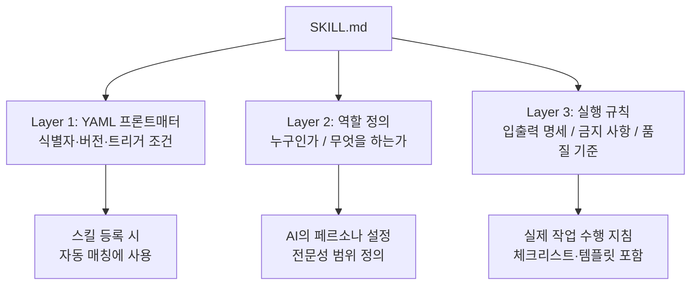
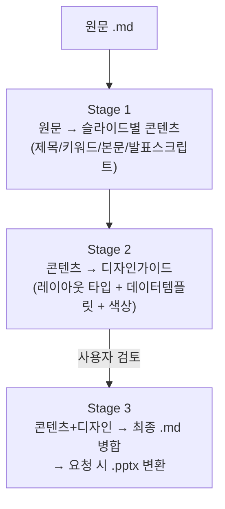
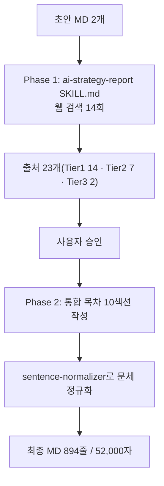
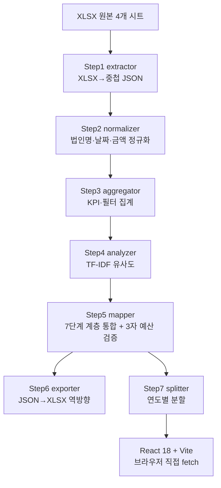
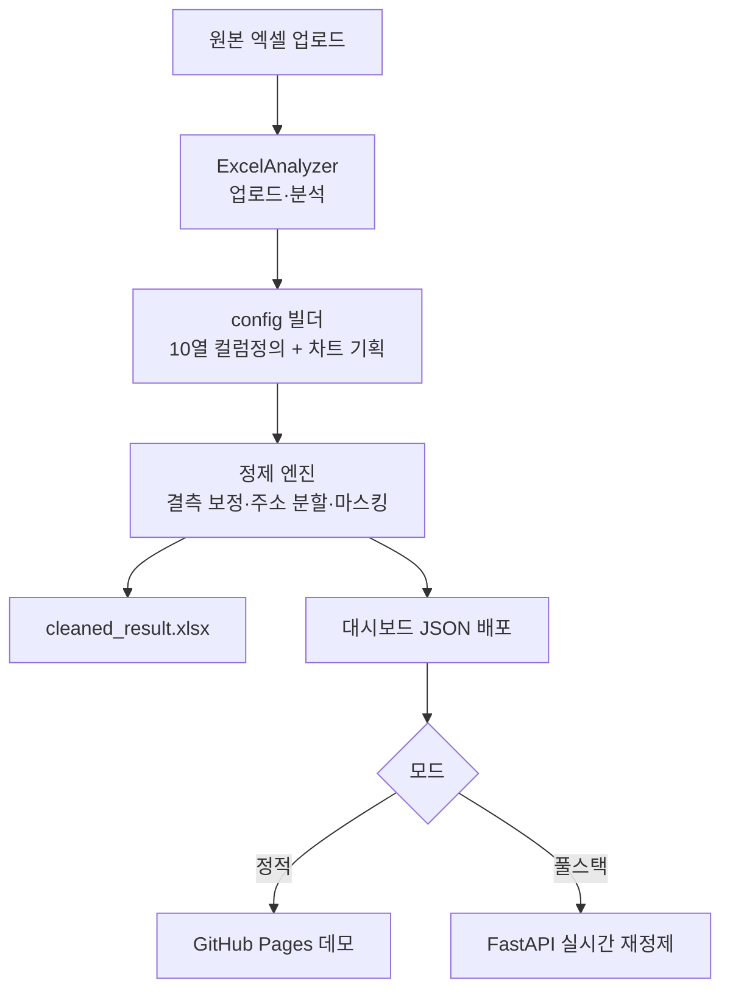
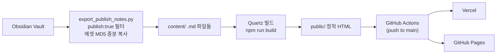
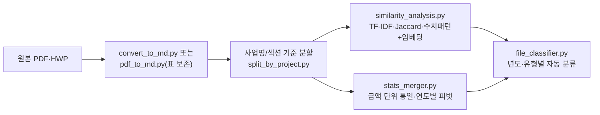

# 1. AI 협업 기초 — SKILL.md 시스템

## SKILL.md란, 왜 필요한가

**SKILL.md(스킬 파일)**는 AI에게 특정 작업에 대한 역할·규칙·출력 형식을 사전 정의한 마크다운 파일. 대화 시작 시 첨부하면 AI는 해당 작업의 전문가 역할을 즉시 수행. AI는 대화가 새로 시작되면 이전 지시를 기억하지 못하므로, "항상 이렇게 해줘"라는 지시는 해당 대화에서만 유효 — SKILL.md는 이 컨텍스트 단절 문제의 해결책.

::: before-after
- title: "SKILL.md 없는 경우"
  desc: "\"정부 AI 정책 보고서 써줘\" → 일반적인 수준의 보고서 생성. 출처 없음, 구조 제각각, 문체 불일치."
- title: "SKILL.md 있는 경우"
  desc: "[ai-strategy-report SKILL.md 첨부] → Phase 1 리서치(웹 검색 10회 이상) → Tier 1~3 출처 분류(수치마다 출처 표기) → □ ○ ― 공문서 구조 + 명사형 종결어미로 자동 완성."
:::

매 보고서 작성 시 초기 지시를 매번 타이핑하면 역할 정의·출처 표기 규칙·구조 규칙·금지 사항 합쳐 약 550자를 월 10회, 월 5,500자 반복 입력. SKILL.md 사용 시에는 파일 첨부 클릭 한 번으로 종료.

## SKILL.md의 3계층 구조

## 실제 사용한 스킬 파일 목록

| 스킬 파일 | 버전 | 역할 |
|-----------|------|------|
| `ai-strategy-report/SKILL.md` | v3.0 | AI·정책 전략 보고서 작성 |
| `hwpx/SKILL.md` | v2.3 | MD → HWPX 자동 변환 |
| `sentence-normalizer/SKILL.md` | v5 | 한국어 공문서 문체 정제 |
| `it-technical-book-writing-skill-prompt/SKILL.md` | v1.1 | IT 기술서 집필 |
| `pptx/SKILL.md` | 공용 | PPTX 슬라이드 생성 |

## 코드 하이라이트 — ai-strategy-report SKILL.md v3.0

::: editor-box
- title: "ai-strategy-report SKILL.md — 출처 신뢰도 Tier 시스템"
  tag: "markdown"
  desc: |
    ## 출처 신뢰도 Tier 시스템

    ### Tier 1 — 최고 신뢰도 (필수 우선 확인)
    기업 공시(SEC 10-K/DART) · 공식 IR 자료 · 정부 공문서 · 학술 논문(arXiv, IEEE)

    ### Tier 2 — 높은 신뢰도 (보조 확인)
    주요 언론(Reuters, AP) · 산업 리포트(Gartner, IDC, McKinsey)

    ### Tier 3 — 참고 수준 (단독 인용 금지)
    개인 블로그, SNS, 커뮤니티 게시글

    ## Phase 1 — 리서치 단계 (최소 10회 검색)
    - [ ] 주제 개요 (2회) · 기업·기관별 동향 · 정책·규제 동향
    - [ ] 시장 규모·전망(Tier 1 우선) · 최신 이벤트·발표

    ## 절대 금지 사항
    - 출처 없는 수치·날짜 기재
    - "~로 알려졌다" 등 불명확 표현
    - Phase 1 없이 바로 Phase 2 진행
:::

## 트러블슈팅 — 하위 폴더 구조 등록 불가

::: alert-box warn
- title: "단일 파일만 업로드 가능합니다"
  desc: "스킬 등록 UI는 하위 폴더 구조(references/sites.md 등 참조 파일 분리) 미지원. 해결: 참조 파일 내용을 SKILL.md 본문에 직접 인라인으로 병합. 파일 크기는 약 100KB 이내 권장이며, 250~350줄 이내로 핵심 규칙만 담는 것이 장기 운용에 유리(500줄 이상이면 후반부 규칙을 AI가 점진적으로 놓치기 시작함)."
:::

::: takeaway-banner
- title: "Key Takeaway"
  desc: "SKILL.md는 AI와의 모든 협업에서 발생하는 컨텍스트 단절 문제의 실질적 해결책이며, 250~350줄 이내의 핵심 규칙만 담고 버전 관리(v3→v4→v5)하는 것이 장기 운용의 핵심."
:::

---

# 2. 문서 자동화 — slide-pipeline과 AI 보고서 제작

## slide-pipeline — 원문에서 PPTX까지 3단계 자동화

기존 방식(PPTX 스타일 추출·재적용)은 콘텐츠와 디자인이 한 파일에 뒤섞여, 디자인만 바꾸고 싶어도 콘텐츠까지 다시 손봐야 하는 구조. slide-pipeline은 **콘텐츠(무엇을 말할 것인가)**와 **디자인(어떻게 보여줄 것인가)**을 완전히 분리한 3단계 파이프라인.

레이아웃 타입은 서술형(단일 메시지) · 종구분형(2단 비교) · 횡구분형(타임라인) 3종으로 자동 분류, 관계의 성격(순서/병렬/포함)에 따라 18종 데이터템플릿 카탈로그에서 시각패턴 선택. "화살표를 없애도 문장이 성립하는가?"가 템플릿 선택의 핵심 판단 기준.

::: editor-box
- title: "addSafeLine() — 파일손상 버그의 근본 해결"
  tag: "javascript"
  desc: |
    // 방향에 따라 폭·높이가 음수가 되는 연결선을 정규화한다.
    // LibreOffice는 음수 extent를 조용히 허용하지만,
    // PowerPoint는 파일 손상(E_FAIL)으로 처리한다.
    function addSafeLine(slide, opts) {
      let { x, y, w, h } = opts;
      let flipH = false, flipV = false;

      if (w < 0) { x += w; w = -w; flipH = true; }
      if (h < 0) { y += h; h = -h; flipV = true; }

      slide.addShape('line', { ...opts, x, y, w, h, flipH, flipV });
    }
:::

::: alert-box warn
- title: "세로 아이콘 배치 시 파일손상(E_FAIL) — 스키마 검증만으론 못 잡음"
  desc: "증상: validate.py는 통과하는데 PowerPoint에서 파일이 아예 안 열림. 원인: 세로 아이콘 3개 배치 시 화살표 텍스트박스 높이가 음수로 계산됨. 발견 경위: 슬라이드 수를 1→2→3→4로 늘려가며 실제 PowerPoint 렌더링으로 이분탐색해서 원인 확정. 교훈: 좌표 계산이 동적인 시각패턴은 극단값까지 실제 렌더링으로 확인 필요."
:::

## AI 보고서 제작 — 3종 스킬 조합 파이프라인

`ai-strategy-report`(리서치·집필) · `sentence-normalizer`(문체 정규화) · `hwpx-renderer`(문서 변환) 3종 스킬을 조합해 "AI 인프라 국가전략 2.0 보고서"(894줄, 52,000자)를 실제로 완성한 과정.

## 트러블슈팅 — 회사 혼동과 단위 혼동

::: before-after
- title: "오류: 회사 혼동"
  desc: "[AI 초안] \"테슬라는 2025년 자체 LLM 'Grok'을 출시하여...\" → 사실 확인: Grok은 테슬라가 아닌 xAI(별도 법인)의 제품."
- title: "수정: 출처 명시로 정정"
  desc: "\"xAI는 2024년 Grok을 출시하였으며, 테슬라와는 별개 법인이다. (출처: xAI 공식 블로그, 2024.11)\" — 수치 단위(달러/엔/원) 혼동도 가장 흔한 오류이므로 모든 수치에 통화 단위 명시."
:::

::: takeaway-banner
- title: "Key Takeaway"
  desc: "AI 전략 보고서 자동화의 핵심은 Phase 1(리서치) → 사용자 승인 → Phase 2(작성)의 단계 분리, Tier 1 출처 우선, 섹션별 독립 작성 후 조립 세 가지. 수치마다 출처를 병기하는 습관이 보고서 신뢰도를 결정."
:::

---

# 3. 데이터 파이프라인 — pjtoverview

R&D 과제 통합 관리 시스템. XLSX 원본을 7단계 파이프라인으로 처리해 백엔드 없이 정적 배포한 사례.

## 설계 결정 — 백엔드 없음

R&D 사업 데이터는 연 1~2회 갱신되는 배치성 데이터이므로 매 요청마다 서버가 응답할 필요가 없다고 판단, 파이프라인 산출물을 정적 JSON으로 커밋하고 React가 브라우저에서 직접 fetch하는 구조로 결정.

::: alert-box tip
- title: "백엔드 없는 구조의 이득과 대가"
  desc: "이득: 서버 운영·인증 인프라 불필요(Vercel 정적 호스팅만으로 배포 완료), 데이터 갱신은 git push 한 번, API 다운타임 자체가 없음. 대가: 실시간 데이터 갱신 불가, 대용량 데이터에는 부적합."
:::

## 코드 하이라이트 — 3자 예산 교차 검증

::: editor-box
- title: "mapper.py — Step5 핵심 로직"
  tag: "python"
  desc: |
    # target: 사업총괄의 "정부지원금.금액" 합
    # actual: 과제목록(project_list)의 예산 합
    # inst_sum: 수행기관(project_institution)의 예산 합

    for key, vals in summary_validation_map.items():
        target = vals["target"]
        actual = vals["actual"]
        inst_sum = vals["inst_sum"]

        # 3개 중 하나라도 다르면 에러 리포트에 추가
        if target != actual or actual != inst_sum:
            self.validation_errors.append({
                "path": vals["path"],
                "summary_target": target,
                "list_actual": actual,
                "institution_sum": inst_sum,
                "status": "Mismatch",
            })
:::

세 시트(사업총괄·과제목록·수행기관)가 같은 예산을 서로 다른 단위에서 집계하는데, 세 개의 독립된 소스가 서로를 검증하는 구조 자체가 이 단계의 핵심. 검증 결과는 `budget_validation.json`으로 저장.

## 트러블슈팅 — 로그인 후 빈 화면

::: alert-box warn
- title: "Supabase 환경변수 누락"
  desc: "현상: 로그인은 성공하는데 화면이 계속 비어 있음. 원인: Vercel에 VITE_SUPABASE_URL 등 환경변수가 등록되지 않아 플레이스홀더가 치환되지 않은 채 배포됨 → Supabase 클라이언트 초기화 실패. 해결: Vercel → Settings → Environment Variables에 등록 후 Redeploy."
:::

::: takeaway-banner
- title: "Key Takeaway"
  desc: "pjtoverview는 대시보드 연동을 FastAPI가 아닌 정적 배포로 완성, 4단계였던 파이프라인은 3자 예산 교차 검증(Step5)이 더해지며 7단계로 확장. 서버가 없다는 설계 결정 하나가 배포 방식·트러블슈팅 유형까지 일관되게 규정."
:::

---

# 4. 시각화 — ClearSurvey

지저분한 설문·행정 엑셀(병합 셀, 표기 불일치, 개인정보 미마스킹, 결측값)을 1-Click으로 정제해 엑셀 요약보고서와 웹 대시보드를 동시에 뽑아내는 시스템.

## 산출물 확장 — 보여주기에서 편집·배포까지

::: icon-grid align=left
- icon: "📊"
  title: "cleaned_result.xlsx"
  desc: "정제 시트 + 요약(Summary) 시트에 openpyxl 네이티브 차트(Bar/Pie)와 Slicer(클릭 필터 버튼)를 함께 주입."
- icon: "📽️"
  title: "대시보드 원클릭 PPTX"
  desc: "현재 필터가 적용된 화면 그대로 PowerPoint로. 이미지가 아니라 pptxgenjs 네이티브 차트 객체로 생성."
- icon: "📄"
  title: "대시보드 원클릭 PDF"
  desc: "차트를 카드 단위로 캡처해 A4 3열×2행 격자에 배치, 페이지마다 프로젝트명·생성일시·페이지번호 머리글."
- icon: "✏️"
  title: "대시보드에서 값 직접 수정"
  desc: "풀스택 모드 전용. 드로어에서 값 수정 → PATCH API → overrides.json 갱신 → 차트·KPI 즉시 갱신(결과 엑셀은 발행 시점에만 rebuild)."
:::

## 코드 하이라이트 — Excel Slicer XML 직접 주입

::: editor-box
- title: "slicer_injector.py — 라이브러리 한계를 파일 포맷 레벨에서 우회"
  tag: "python"
  desc: |
    # .xlsx는 ZIP이므로, openpyxl이 못 만드는 슬라이서를
    # XML 레벨에서 직접 주입한다.
    #
    # 필요한 추가 파트:
    #   xl/slicers/slicer1.xml          — 슬라이서 정의
    #   xl/slicerCaches/slicerCache1.xml — 참조 캐시(고유값 목록)
    #   [Content_Types].xml             — 새 파트의 MIME 타입 선언
    #
    # 주의: 표(Table)가 먼저 있어야 슬라이서가 참조할 대상이 생긴다.
:::

## 트러블슈팅 — 슬라이서 포함 시 "복구가 필요합니다" 오류

::: alert-box warn
- title: "[2026-08-25 기준 미해결] 원인 격리는 완료, 근본 수정 진행 중"
  desc: "Excel COM 자동화로 이진 탐색한 결과 슬라이서 관련 파일(drawing2.xml+slicerN.xml)만 단독으로 재현됨을 확인했으나 정확한 결함 지점은 미확정. 임시 우회책(검증 완료): 설정 화면에서 \"슬라이서 포함\" 체크를 해제하고 재실행하면 차트·표는 정상 유지, 슬라이서만 제외."
:::

::: takeaway-banner
- title: "Key Takeaway"
  desc: "ClearSurvey의 핵심은 정제 규칙을 코드가 아니라 config(YAML)로 선언하고, 라이브러리가 못 만드는 기능(엑셀 슬라이서, PPTX 네이티브 차트)은 파일 포맷을 직접 조작해 구현한다는 것."
:::

---

# 5. 옵시디언 위키 발행시스템 — mywiki

Obsidian 노트를 Quartz 빌드로 변환해 Vercel/GitHub Pages에 이중 배포하는 개인 지식 창고. `publish: true` 메타데이터가 붙은 노트만 웹에 공개되는 선택적 공개 구조.

## 핵심 기능

::: icon-grid align=left
- icon: "🧠"
  title: "Digital Garden"
  desc: "Obsidian 위키링크·백링크·그래프 뷰를 웹에서 그대로 제공."
- icon: "🔒"
  title: "선택적 공개"
  desc: "Obsidian 노트에 publish: true 설정한 파일만 빌드에 포함."
- icon: "⚡"
  title: "증분 동기화"
  desc: "export_publish_notes.py가 MD5 해시 비교로 변경된 파일·에셋만 복사."
- icon: "🔍"
  title: "전문 검색"
  desc: "FlexSearch 기반 클라이언트 사이드 풀텍스트 검색, RSS Feed 자동 생성."
:::

## 노트 발행 워크플로우

::: step-flow
- icon: "✍️"
  title: "노트 작성"
  desc: "frontmatter에 publish: true 설정"
  tag: "active"
- type: "arrow"
- icon: "🔄"
  title: "동기화"
  desc: "python export_publish_notes.py"
- type: "arrow"
- icon: "🏗️"
  title: "빌드"
  desc: "npm run build → public/"
- type: "arrow"
- icon: "🚀"
  title: "배포"
  desc: "git push → Actions가 자동 빌드+배포"
:::

::: alert-box tip
- title: "이중 배포 구조"
  desc: "Vercel은 별도 GitHub Actions 없이 main 브랜치 push를 감지해 자체 빌드하고, GitHub Actions는 checkout → npm ci → npm run build → GitHub Pages 배포를 수행. 두 배포가 동시에 독립적으로 동작."
:::

## 트러블슈팅

::: faq-list
- title: "노트가 사이트에 안 보임"
  desc: "원인: publish: true가 없거나 draft: true로 설정됨. 해결: Frontmatter 확인."
- title: "이미지가 깨짐"
  desc: "원인: export_publish_notes.py 미실행. 해결: 스크립트 재실행 후 빌드."
- title: "로컬 빌드는 되는데 Actions에서 실패"
  desc: "원인: fetch-depth: 0 누락(git 날짜 메타 필요). 해결: deploy.yaml 체크."
- title: "한글 파일명 및 탐색기 정렬 오동작"
  desc: "원인: FolderPage 데이터 구조 미스매치 및 빌드 시 date 속성 유실. 해결: quartz.config.ts의 sort 함수와 contentIndex.tsx 설정 수정."
:::

::: takeaway-banner
- title: "Key Takeaway"
  desc: "노트 작성(Obsidian) → 선택적 동기화(publish: true 필터) → 빌드(Quartz v5) → 이중 배포(Vercel + GitHub Pages)로 이어지는 구조가 핵심. 정적 사이트 생성기 한 벌로 개인 지식창고를 서버 없이 계속 운영 가능."
:::

---

# 6. 진행 중 프로젝트 — doc-analysis

정부 예산 설명자료·사업계획서·성과보고서 같은 내부 기밀문서를 **외부 클라우드로 절대 내보내지 않고** 100% 로컬 환경에서 파싱·분할·유사도 대조·통계 피벗·자동 분류까지 처리하는 진행 중인 플랫폼.

::: alert-box warn
- title: "진행 상태 — 정직하게 기록"
  desc: "핵심 스크립트 6종은 각각 동작하지만, 6개 스크립트를 하나의 자동 파이프라인으로 엮는 오케스트레이션과 대량 문서 검증은 아직 미완료. 완성된 것처럼 포장하지 않고 지금 상태를 그대로 기록."
:::

## 로컬 임베딩 — 외부 서버 완전 차단

::: cmd-box
- title: "6단계 스크립트 실행 순서"
  tag: "powershell"
  desc: |
    # 1. 마크다운 변환 (표 보존이 중요하면 pdf_to_md.py)
    python scripts/pdf_to_md.py

    # 2. 사업 단위 문서 자동 분할
    python scripts/split_by_project.py --profile budget_table

    # 3. 다차원 유사도 분석 (TF-IDF + Jaccard + 수치패턴 + 문맥 임베딩)
    python scripts/similarity_analysis.py

    # 4. 한국어 금액 단위(억원·조원·만원) 코어싱 + 연도별 피벗
    python scripts/stats_merger.py

    # 5. 파일명 표준화 + 년도/유형별 폴더 자동 분류
    python scripts/file_classifier.py --execute
:::

유사성 검증 시 `jhgan/ko-sbert-nli` 가중치 모델을 로컬 캐시에서 직접 로드하며, `HF_HUB_OFFLINE=1` + `local_files_only=True`로 HuggingFace 서버 연결을 물리적으로 차단. API Key를 쓰는 라이브러리는 아예 쓰지 않아 유출 경로 자체를 설계에서 제거.

## 왜 필요한가 — 거버넌스 우선 설계

::: summary-box
- title: "클라우드 LLM에 올릴 수 없는 문서들"
  desc: "부처 예산 설명자료·사업계획서·성과보고서 같은 내부 기밀문서는 클라우드 LLM에 붙여넣는 것 자체가 보안 규정 위반. AGENTS.md(AI PMO 거버넌스 마스터 규칙)가 TDD 개발 표준, 하드코딩 전면 배제, 외부 유출 차단 가드레일을 설계 단계부터 명문화 — 코드보다 규칙 문서가 먼저 만들어진 프로젝트."
:::

::: takeaway-banner
- title: "Key Takeaway"
  desc: "doc-analysis는 \"외부로 나갈 수 없는 문서는 로컬에서 끝까지 처리한다\"는 원칙 하나로 설계. 6개 스크립트 각각은 동작하지만, 아직 하나의 완결된 파이프라인으로 엮이지는 않은 진행 중인 프로젝트."
:::
